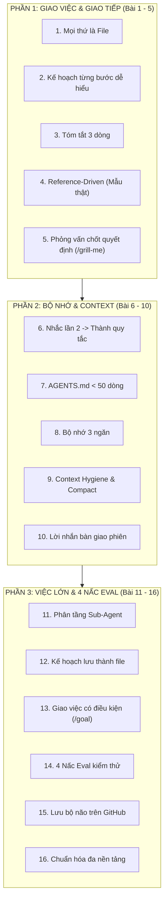
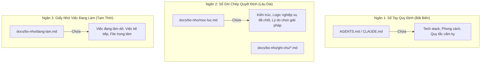
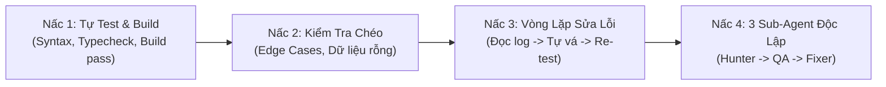

# 16 BÀI HỌC SAU 1000 GIỜ SỬ DỤNG CLAUDE
> **Cẩm Nang Thực Chiến Biến AI Thành Cộng Sự Đắc Lực Trong Mọi Dự Án**  
> *Đúc kết từ chuỗi bài giảng & kinh nghiệm thực chiến của Nhật Anh AI ([nhatanh.ai/1000-gio](https://nhatanh.ai/1000-gio/) · [YouTube Video](https://www.youtube.com/watch?v=mM0YzxgeyJQ))*

---

## 🧭 LỜI MỞ ĐẦU & CÁCH DÙNG TÀI LIỆU NÀY

Tài liệu này tổng hợp toàn bộ tri thức, tư duy và kỹ thuật cốt lõi sau hơn 1000 giờ vận hành Claude & AI Coding Agent. 

Khi bắt đầu một dự án mới, bạn có 2 cách sử dụng:
1. **Dùng làm cẩm nang hướng dẫn cho chính bạn:** Đọc lại các nguyên tắc giao việc, các câu lệnh mẫu (prompts), cách tổ chức bộ nhớ và quy trình kiểm thử (Eval).
2. **Thả trực tiếp vào dự án cho AI đọc:** Bạn có thể copy file `AGENTS.md` / `CLAUDE.md` (mục lục chỉ dẫn tinh gọn ở phần phụ lục) và thư mục `docs/bo-nho/` vào root dự án của bạn để AI Agent tự động tuân thủ ngay từ ngày đầu.



---

# PHẦN 1: NGHỆ THUẬT GIAO VIỆC & GIAO TIẾP VỚI CLAUDE (BÀI 1 → 5)

---

### Bài 1: Claude Code Không Chỉ Để Lập Trình — Mọi Thứ Đều Là File
- **Bản chất:** AI Agent như Claude Code, Antigravity có quyền đọc, ghi, chỉnh sửa và chạy lệnh trên máy tính của bạn. Tất cả sản phẩm số cuối cùng đều tồn tại dưới dạng file:
  - Trang web (`.html`, `.tsx`, `.vue`)
  - Báo cáo số liệu & biểu đồ (`.xlsx`, `.csv`, `.pdf`)
  - Bản trình chiếu slide (`.marp.md`, `.reveal.html`)
  - Ảnh đồ họa / Đồ họa chuyển động (`.svg`, Canvas, `.remotion`)
  - Bài viết tài liệu, khóa học, kịch bản (`.md`, `.docx`)
- **Tư duy thực hành:** Đừng chỉ giới hạn AI trong việc sửa code bug. Hãy coi Agent là trợ lý văn phòng, thiết kế và nghiên cứu toàn năng.
- **Lời nhắn mẫu (Prompt):**
  ```text
  Hãy đóng vai một chuyên gia phân tích quy trình công việc. 
  Hãy phỏng vấn mình 3 câu ngắn về các công việc hành chính/nội dung/dữ liệu mình làm hàng ngày. 
  Sau đó, đề xuất 5 việc phi lập trình mà bạn có thể tự động hóa hoặc tạo ra dưới dạng file ngay trên máy tính của mình, kèm theo ước tính thời gian tiết kiệm mỗi tuần.
  ```

---

### Bài 2: Nói Tiếng Người & Lên Kế Hoạch Từng Bước Dễ Hiểu
- **Bản chất:** Đừng để AI lao vào gõ code bừa bãi hoặc nói toàn thuật ngữ khó hiểu. Với bất kỳ tác vụ nào lớn hơn 1 thao tác nhỏ, luôn yêu cầu AI lập kế hoạch trước.
- **Tiêu chuẩn kế hoạch 3 yếu tố:**
  1. **Làm gì:** Mô tả bằng lời thường dễ hiểu.
  2. **Ở file nào:** Chỉ rõ đường dẫn file cụ thể.
  3. **Thế nào là xong:** Tiêu chuẩn nghiệm thu đo lường được (Test gì, màn hình hiển thị thế nào).
- **Quy tắc sau mỗi bước:** Yêu cầu AI tóm tắt ngắn gọn việc vừa hoàn thành; nếu gặp lỗi, giải thích bằng lời thường và nêu hướng xử lý trước khi làm tiếp.
- **Lời nhắn mẫu (Prompt):**
  ```text
  Trước khi thực hiện, hãy lên kế hoạch từng bước theo định dạng:
  - Bước X: [Làm gì] -> File: [Đường dẫn file] -> Tiêu chí xong: [Cách kiểm tra].
  Giải thích bằng tiếng Việt bình dân, không dùng biệt ngữ kỹ thuật phức tạp. Sau khi mình đồng ý kế hoạch thì mới bắt đầu làm bước 1.
  ```

---

### Bài 3: Nói Tự Nhiên & Lộn Xộn — Tóm Tắt 3 Dòng Trước Khi Làm
- **Bản chất:** Gõ phím rất lâu và cản trở dòng suy nghĩ. Sử dụng tính năng nhập giọng nói (`Windows + H` trên Windows hoặc nhấn phím `Fn` 2 lần trên Mac) để xả suy nghĩ tự nhiên.
- **Vấn đề phát sinh:** Nói bằng giọng nói thường lan man, có từ thừa hoặc lộn xộn thứ tự.
- **Quy tắc 3 dòng:** AI phải tóm tắt lại toàn bộ mong muốn cốt lõi của người dùng trong **đúng 3 dòng gạch đầu dòng** và hỏi lại những điểm còn thiếu trước khi bắt tay vào sửa code hay tạo file.
- **Lời nhắn mẫu (Prompt gắn vào hệ thống):**
  ```text
  Khi người dùng nhập văn bản dài, tự nhiên hoặc lộn xộn (nhập bằng giọng nói), bạn phải:
  1. Tóm tắt lại yêu cầu cốt lõi trong đúng 3 dòng ngắn gọn.
  2. Nêu rõ các thông tin/dữ liệu quan trọng còn thiếu.
  3. Chờ người dùng xác nhận đúng hướng trước khi thao tác hàng loạt.
  ```

---

### Bài 4: Làm Theo Ví Dụ Thật (Reference-Driven)
- **Bản chất:** Mô tả cái đẹp hay đúng bằng lời rất trừu tượng ("làm giao diện sang trọng, bố cục gọn gàng"). AI sẽ đoán mò và thường cho kết quả thất vọng.
- **Nguyên tắc:** Luôn cung cấp **ví dụ mẫu thực tế** (ảnh chụp màn hình giao diện bạn thích, đoạn code tham khảo, mẫu báo cáo Excel, văn phong bài viết chuẩn).
- **Quy trình 2 bước khi xử lý mẫu:**
  1. **Bóc tách 3 đến 5 điểm đắt giá:** AI phải chỉ ra điểm hay của mẫu (tỷ lệ khoảng trắng, màu sắc chủ đạo, nhịp điệu typography, cách sắp xếp nút bấm).
  2. **Phân định rõ ranh giới:** Nêu rõ **Phần giữ nguyên** (theo phong cách mẫu) và **Phần thay đổi** (theo dữ liệu/nghiệp vụ của dự án này).
- **Lời nhắn mẫu (Prompt):**
  ```text
  Mình gửi bạn ảnh/tài liệu mẫu này. 
  Hãy phân tích và chỉ ra 3-5 điểm đắt giá nhất làm nên chất lượng của mẫu. 
  Sau đó, lập bảng:
  - Cột 1: Những thành phần giữ nguyên theo phong cách của mẫu.
  - Cột 2: Những chi tiết cần thay đổi để phù hợp với nghiệp vụ dự án này.
  ```

---

### Bài 5: Phỏng Vấn Trước Quyết Định Lớn (`/grill-me`)
- **Bản chất:** Khi gặp một bài toán thiết kế tính năng mới hoặc quyết định kiến trúc quan trọng, đừng để AI tự quyết một mình và cũng đừng để người dùng phải tự nghĩ hết mọi trường hợp.
- **Quy tắc phỏng vấn 1-1:**
  1. AI phỏng vấn người dùng, **mỗi lượt chỉ hỏi duy nhất 1 câu**.
  2. Trong câu hỏi, **luôn đưa ra phương án gợi ý của AI** (kèm lý do) để người dùng chỉ cần gật đầu, chọn lựa hoặc điều chỉnh nhẹ.
  3. Quyết định nào được chốt phải ghi ngay vào file ghi chú (`docs/bo-nho/`).
- **Lời nhắn mẫu (Prompt):**
  ```text
  Hãy đóng vai Tech Lead/Chuyên gia nghiệp vụ, phỏng vấn mình để làm rõ yêu cầu cho tính năng [Tên tính năng].
  Quy tắc: Mỗi lần bạn chỉ hỏi ĐÚNG 1 CÂU, kèm theo phương án bạn đề xuất (A/B) để mình dễ dàng lựa chọn. Khi nào đủ thông tin, hãy tổng hợp lại thành văn bản chốt.
  ```

---

# PHẦN 2: QUẢN TRỊ BỘ NHỚ 3 NGĂN & CONTEXT HYGIENE (BÀI 6 → 10)

---

### Bài 6: Nhắc Lần 2 Thì Thành Quy Tắc (Two-Strike Rule)
- **Bản chất:** Trong quá trình làm việc, nếu người dùng phải nhắc hoặc sửa AI về một thói quen, phong cách viết code, hay quy ước nghiệp vụ đến **lần thứ hai**, đó là tín hiệu bắt buộc phải hệ thống hóa.
- **Hành động tức thì:** AI chủ động đề xuất 1 dòng quy tắc ngắn gọn, xin phép người dùng được ghi bổ sung vào file chỉ dẫn dự án (`AGENTS.md` hoặc `CLAUDE.md`).
- **Ví dụ đề xuất của AI:**
  > *"Em nhận thấy đây là lần thứ 2 anh nhắc về việc dùng tiếng Việt có dấu cho thông báo toast. Em xin phép thêm dòng sau vào AGENTS.md được không ạ: `Mọi thông báo giao diện (toast, alert) bắt buộc dùng tiếng Việt có dấu, không dùng tiếng Anh.`"*

---

### Bài 7: Giữ File Chỉ Dẫn Dưới 50 Dòng (Dạng Mục Lục Chỉ Đường)
- **Vấn đề:** Nhiều người nhồi nhét toàn bộ hướng dẫn, API docs, coding style vào `CLAUDE.md` khiến file dài 500 - 1000 dòng. Hệ quả: Context bị loãng, chi phí token tăng cao, AI bị "mù thông tin" và thường xuyên bỏ qua các quy tắc quan trọng.
- **Quy tắc vàng:** `AGENTS.md` / `CLAUDE.md` tại thư mục gốc **bắt buộc dưới 50 dòng**.
- **Cấu trúc chuẩn:** Đóng vai trò như một **Mục lục chỉ đường (Index)**:
  - 10 dòng: Nhận diện dự án & Tech stack chính.
  - 15 dòng: 3-5 quy tắc cốt lõi bất biến.
  - 15 dòng: Đường dẫn trỏ tới các file chi tiết trong thư mục `docs/` hoặc `.agents/skills/`.

---

### Bài 8: Vận Hành Hệ Thống Bộ Nhớ 3 Ngăn
Trí nhớ của AI giống như một nhân viên mới đến công ty mỗi sáng. Muốn làm việc hiệu quả lâu dài qua nhiều ngày/tuần, dự án phải có cấu trúc bộ nhớ 3 ngăn rõ ràng:



1. **Ngăn 1 - Sổ tay quy định (`AGENTS.md` / `CLAUDE.md`):** Luôn tự động nạp ở đầu phiên. Quy định người dùng là ai, tech stack là gì, quy tắc bắt buộc.
2. **Ngăn 2 - Sổ ghi chép quyết định (`docs/bo-nho/muc-luc.md`):** Lưu trữ các quyết định quan trọng kèm lý do ("Tại sao lại chọn SQLite thay vì Postgres?"). Khi cần tra cứu thì mở đọc, không nhồi vào prompt chính.
3. **Ngăn 3 - Giấy nhớ việc đang làm (`docs/bo-nho/dang-lam.md`):** Cập nhật liên tục. Trước khi tắt máy nghỉ, ghi lại đang dừng ở đâu, bước kế tiếp cần làm gì.

---

### Bài 9: Giữ Context Gọn & Sạch (Chống Suy Giảm Ngữ Cảnh)
- **Thực tế kỹ thuật:** Nghiên cứu cho thấy khi độ dài Context Window tăng từ 256K lên 1M tokens, độ chính xác trong việc truy xuất chi tiết (Needle-in-a-haystack) và suy luận logic giảm từ **~93% xuống ~76%**.
- **Giải pháp giữ Context sạch:**
  1. Dùng lệnh `/compact` thường xuyên sau khi giải quyết xong một lỗi hoặc chốt xong một mục lớn.
  2. Không để log lỗi dài hàng ngàn dòng tràn vào cửa sổ chat chính (giao cho sub-agent đọc hoặc trích xuất 10 dòng lỗi chính).
  3. Khi một chủ đề đã hoàn thành trọn vẹn, cập nhật vào `docs/bo-nho/dang-lam.md` và bắt đầu phiên chat mới (New Session).

---

### Bài 10: Viết Lời Nhắn Bàn Giao Phiên Mới (Handover Note Pattern)
- **Sai lầm phổ biến:** Mở cửa sổ chat mới và nói: *"Làm tiếp dự án nhé"* hoặc *"Hôm qua mình làm đến đâu rồi nhỉ?"*. AI sẽ mất 5-10 lượt quét lại toàn bộ file, vừa tốn tiền vừa dễ hiểu sai.
- **Quy trình chuẩn bàn giao 1 lần:** Copy đúng 1 lời nhắn chuẩn sang phiên mới:
  ```markdown
  Chào bạn, mình tiếp tục dự án [Tên dự án]. Bạn hãy đọc file docs/bo-nho/dang-lam.md để nắm ngữ cảnh hiện tại.
  
  ### Việc vừa hoàn thành ở phiên trước
  - Đã tích hợp API đăng nhập Google Auth.
  - Đã cấu hình xong database migration.
  
  ### Việc cần làm ngay bây giờ (theo thứ tự)
  1. Viết middleware xác thực JWT trong authMiddleware.ts.
  2. Viết test case kiểm tra token hết hạn.
  
  ### File trọng tâm cần làm việc
  - src/middlewares/authMiddleware.ts
  - src/tests/auth.test.ts
  
  ### Quyết định đã chốt cần lưu ý
  - Sử dụng accessToken thời hạn 15 phút, refreshToken lưu trong HttpOnly cookie (xem docs/bo-nho/ghi-chu/auth-design.md).
  ```

---

# PHẦN 3: TÁC VỤ LỚN, SUB-AGENT & 4 NẤC EVAL KIỂM THỬ (BÀI 11 → 16)

---

### Bài 11: Phân Tầng Sub-Agent (Model To Nghĩ, Model Nhỏ Đọc)
- **Nguyên lý:** Không sử dụng model tư duy mạnh nhất, đắt nhất (Claude 3.7 Sonnet / Opus) để làm những việc tốn công đọc tài liệu, quét file log hoặc cào dữ liệu web.
- **Phân công nhiệm vụ:**
  - **Main Agent (Model tư duy cao - Opus / Sonnet / Pro):** Lập kế hoạch kiến trúc, phản biện, tổng hợp kết quả, viết code nghiệp vụ nòng cốt.
  - **Sub-Agent (Model nhẹ, siêu tốc - Haiku / Flash / Flash Lite):** Đọc các tài liệu dài hàng nghìn trang, tìm kiếm file trong thư mục, tóm tắt log kiểm thử, quét mã nguồn tìm vị trí bug.
- Giúp tiết kiệm 70-80% chi phí và giữ phiên làm việc chính luôn sạch sẽ, sắc bén.

---

### Bài 12: Kế Hoạch Lớn Bắt Buộc Lưu Thành File (`ke-hoach.md`)
- **Vấn đề:** Nếu kế hoạch chỉ nằm trên màn hình chat, khi cửa sổ chat bị đầy (context reset) hoặc khi bạn chuyển sang máy khác làm việc, kế hoạch sẽ biến mất.
- **Giải pháp:** Với bất kỳ dự án nào có từ 3 bước trở lên, tạo file `docs/bo-nho/ke-hoach.md` dưới dạng checklist markdown:
  ```markdown
  # Kế hoạch phát triển Module Thanh Toán
  - [x] Bước 1: Thiết kế schema bảng Transaction (db/schema.sql)
  - [x] Bước 2: Tạo Stripe Webhook handler (src/api/webhook.ts)
  - [ ] Bước 3: Viết logic xử lý sự kiện payment_intent.succeeded
  - [ ] Bước 4: Viết unit test giả lập thanh toán thất bại
  - [ ] Bước 5: Chạy full test & verify build production
  ```
- Khi làm xong bước nào, AI sửa file để đánh dấu tick `[x]` ngay lập tức.

---

### Bài 13: Giao Việc Kèm Điều Kiện Hoàn Thành (`/goal` / Ralph Loop)
- **Bản chất:** Thay vì ngồi canh từng câu lệnh ("Agent-in-the-loop"), bạn muốn giao việc cho Agent tự động chạy ngầm qua đêm hoặc chạy xuyên suốt ("Agent-on-the-loop").
- **3 Yếu tố cốt tử của một tác vụ tự động:**
  1. **Tiêu chí hoàn thành đo lường được:** Không nói "làm cho đẹp", hãy nói "toàn bộ 12 test case trong vitest đều PASS".
  2. **Bằng chứng xác thực (Proof of work):** Bắt buộc in ra log test pass hoặc đường link file kết quả có dung lượng > 0 byte.
  3. **Giới hạn số vòng lặp tối đa (Max iterations):** Đặt giới hạn (ví dụ tối đa 10 lượt thử) để tránh vòng lặp vô tận gây tốn chi phí nếu gặp bế tắc logic.

---

### Bài 14: 4 Nấc Eval — Nghiêm Cấm Báo Xong Khi Chưa Chạy Thử
Quy tắc sống còn: **AI không bao giờ được phép nói "Tôi đã sửa xong" nếu chưa tự tay kiểm chứng kết quả.**



#### Chi tiết 4 Nấc Eval:
1. **Nấc 1 - Tự kiểm tra cơ bản:** Chạy ngay lệnh build hoặc test (`npm run build`, `npm test`, `pytest`). Nếu có lỗi cú pháp hoặc typecheck, tự sửa trước khi nói chuyện với người dùng.
2. **Nấc 2 - Kiểm tra chéo trường hợp biên (Edge Cases):** Chủ động kiểm tra xem ứng dụng có chạy đúng khi: dữ liệu rỗng, tên có dấu, mạng ngắt kết nối, người dùng bấm nút 2 lần liên tục.
3. **Nấc 3 - Vòng lặp tự kiểm tra & sửa chữa (Eval Loop):** Nếu test hỏng, AI tự phân tích log lỗi, đưa ra giả thuyết, sửa code và chạy lại test cho đến khi toàn bộ chuyển sang màu xanh (Green).
4. **Nấc 4 - Đội ngũ 3 Agent độc lập (Bug Hunt Pipeline):**
   - Agent viết code thường có "điểm mù" (tự tin thái quá vào code của mình). Với tác vụ phức tạp, chia làm 3 agent riêng biệt:
     - **Agent 1 (`bug_hunter` - Chỉ đọc):** Quét code tìm lỗ hổng logic, xuất danh sách `[BUG-01]`, `[BUG-02]`.
     - **Agent 2 (`qa_tester`):** Nhận danh sách bug, viết file test tự động tái hiện chính xác lỗi đó (Red Test).
     - **Agent 3 (`dev_fixer`):** Sửa code cho đến khi tất cả các test của QA Tester đều PASS (Green Build).

---

### Bài 15: Lưu Trữ "Bộ Não" Trên GitHub
- **Bản chất:** Quy tắc `AGENTS.md`, cấu trúc `docs/bo-nho/`, và các file kỹ năng tự chế `.agents/skills/` chính là "tài sản trí tuệ" và "bộ não dự án" của bạn.
- **Quy tắc bảo mật bất di bất dịch:**
  - **COMMIT:** Cấu trúc dự án, tài liệu thiết kế, quy ước code, test cases, prompt rules.
  - **KHÔNG COMMIT (Đưa vào `.gitignore`):** File `.env`, API Keys, Token ngân hàng, mật khẩu database, dữ liệu khách hàng cá nhân.
- Giúp bạn đổi máy tính, lên VPS, hoặc chia sẻ cho đồng nghiệp mà AI vẫn giữ nguyên 100% ngữ cảnh và thói quen làm việc.

---

### Bài 16: Chuẩn Hóa Đa Nền Tảng (`AGENTS.md`)
- **Tầm nhìn:** Không để bản thân bị phụ thuộc độc quyền vào bất kỳ công cụ AI đơn lẻ nào.
- File `AGENTS.md` là chuẩn mở được hỗ trợ bởi hầu hết các AI Coding Assistant hàng đầu hiện nay:
  - **Claude Code** (Anthropic)
  - **Antigravity** (Google)
  - **Cursor** / **Windsurf** / **GitHub Copilot**
  - **Codex** (OpenAI)
- Viết một lần theo chuẩn chuẩn hóa, bạn có thể chuyển đổi linh hoạt giữa các Agent tùy theo thế mạnh của từng mô hình tại từng thời điểm.

---

# PHẦN 4: BỘ FILE MẪU CHUẨN ĐỂ THẢ VÀO DỰ ÁN MỚI

Khi bạn khởi tạo một dự án mới, hãy tạo cấu trúc file như sau tại thư mục gốc:

```text
ten-du-an/
├── AGENTS.md                    <-- File chỉ dẫn cốt lõi (< 50 dòng)
├── CLAUDE.md                    <-- (Tùy chọn) Alias liên kết hoặc tương đương
└── docs/
    └── bo-nho/
        ├── dang-lam.md          <-- Giấy nhớ việc đang làm dở
        ├── muc-luc.md           <-- Sổ ghi chép các quyết định
        ├── ke-hoach.md          <-- Kế hoạch từng bước của tác vụ lớn
        └── ghi-chu/             <-- Các tài liệu chi tiết (nếu có)
```

---

## 1. Mẫu File `AGENTS.md` (Chuẩn < 50 Dòng Sẵn Sàng Copy)

```markdown
# Chỉ Dẫn Hoạt Động Của Agent Trong Dự Án

## 1. Dự Án & Công Nghệ
- Dự án: [Tên dự án của bạn]
- Tech stack: [Ví dụ: React 19, TypeScript, Tailwind CSS, Vite, SQLite]
- Ngôn ngữ giao tiếp: Tiếng Việt (ngắn gọn, kết luận trước, kèm link file click được).

## 2. Quy Tắc 1000 Giờ Bắt Buộc Tuân Thủ
1. **Lập kế hoạch trước:** Việc lớn phải lên kế hoạch từng bước (Làm gì, File nào, Nghiệm thu thế nào).
2. **Tóm tắt 3 dòng:** Nếu yêu cầu dài/lộn xộn từ giọng nói, tóm tắt lại trong 3 dòng trước khi sửa code.
3. **Reference-Driven:** Khi có ảnh/code mẫu, phân tích 3-5 điểm đắt giá; chỉ rõ phần giữ nguyên và phần đổi mới.
4. **Phỏng vấn 1-1:** Khi chốt tính năng, hỏi từng câu một kèm phương án gợi ý của bạn.
5. **Nhắc lần 2 thành rule:** Khi người dùng sửa bạn đến lần thứ 2 về cùng một việc, đề xuất 1 dòng thêm vào file này.
6. **Không báo xong bừa:** Bắt buộc chạy build/test (Eval Nấc 1 & 2) trước khi báo hoàn thành.
7. **Cập nhật bộ nhớ:** Chốt quyết định ghi vào `docs/bo-nho/muc-luc.md`; dừng phiên cập nhật `docs/bo-nho/dang-lam.md`.

## 3. Bản Đồ Tài Liệu Chi Tiết
- Việc đang làm & Bước kế tiếp: [docs/bo-nho/dang-lam.md](file://docs/bo-nho/dang-lam.md)
- Quyết định kiến trúc đã chốt: [docs/bo-nho/muc-luc.md](file://docs/bo-nho/muc-luc.md)
- Kế hoạch tổng thể: [docs/bo-nho/ke-hoach.md](file://docs/bo-nho/ke-hoach.md)
```

---

## 2. Mẫu File `docs/bo-nho/dang-lam.md` (Giấy Nhớ Việc Đang Làm)

```markdown
# Giấy Nhớ Việc Đang Làm

> File này được cập nhật liên tục trước khi dừng phiên làm việc để không bao giờ bị mất ngữ cảnh.

## 1. Trạng Thái Hiện Tại
- **Module đang làm:** [Tên tính năng hoặc module]
- **Tình trạng:** [Đang làm dở / Đang debug / Chờ review]

## 2. Việc Vừa Hoàn Thành Trong Phiên Này
- [x] Tạo khung schema database.
- [x] Viết API endpoint `/api/v1/auth/login`.

## 3. Việc Cần Làm Ngay Khi Bắt Đầu Phiên Tới (Theo Thứ Tự)
1. [ ] Viết hàm validate mật khẩu trong `src/utils/hash.ts`.
2. [ ] Viết test case giả lập đăng nhập sai mật khẩu 5 lần.
3. [ ] Chạy `npm test` kiểm tra toàn bộ module auth.

## 4. File Trọng Tâm Liên Quan
- `src/controllers/authController.ts`
- `src/utils/hash.ts`
- `src/tests/auth.test.ts`

## 5. Lưu Ý / Vấn Đề Tồn Đọng
- Cần chú ý mã hóa UTF-8 cho tên người dùng tiếng Việt.
- Chưa xử lý rate limit cho API login.
```

---

## 3. Mẫu File `docs/bo-nho/muc-luc.md` (Sổ Ghi Chép Quyết Định)

```markdown
# Sổ Ghi Chép Quyết Định Kiến Trúc & Nghiệp Vụ

Mỗi khi chốt một quyết định quan trọng cùng người dùng (sau phỏng vấn `/grill-me`), ghi 1 dòng vào bảng này để AI và lập trình viên luôn nhớ lý do tại sao làm như vậy.

| STT | Ngày | Quyết Định Đã Chốt | Lý Do & Ngữ Cảnh | File Chi Tiết |
| :--- | :--- | :--- | :--- | :--- |
| QD-01 | 2026-11-06 | Dùng SQLite làm DB chính | Dự án chạy offline/local, không cần setup server phức tạp | docs/bo-nho/ghi-chu/db-choice.md |
| QD-02 | 2026-11-06 | Mọi thông báo đều dùng Tiếng Việt | Yêu cầu đối tượng người dùng cuối là nhân viên kế toán VN | AGENTS.md |
| QD-03 | 2026-11-06 | Token Auth lưu HttpOnly Cookie | Tránh lỗ hổng XSS đánh cắp accessToken từ localStorage | docs/bo-nho/ghi-chu/auth-security.md |
```

---

## 4. Khung Lời Nhắn Bàn Giao Sang Phiên Mới (Copy 1 Click)

```text
Chào bạn, mình tiếp tục làm việc trên dự án này. 
Bạn hãy đọc nhanh file `docs/bo-nho/dang-lam.md` để nắm trạng thái hiện tại.

Nhiệm vụ cụ thể của phiên này:
1. Tiếp tục thực hiện mục 3 trong docs/bo-nho/dang-lam.md.
2. Kiểm tra lại theo đúng các quy tắc trong AGENTS.md.
3. Khi hoàn thành, tự động chạy test/build (Eval) và cập nhật lại trạng thái mới vào docs/bo-nho/dang-lam.md.

Hãy xác nhận bạn đã đọc xong và nêu kế hoạch 3 bước trước khi làm nhé!
```

---

# TỔNG KẾT BẢNG TRA CỨU NHANH 16 BÀI HỌC

| STT | Tên Bài Học | Hành Động Cụ Thể | Công Cụ / File Áp Dụng |
| :---: | :--- | :--- | :--- |
| **01** | Mọi thứ đều là file | Giao cả việc web, excel, pdf, slide, video | File system & Terminal |
| **02** | Nói tiếng người | Lên kế hoạch 3 phần: Làm gì, Ở đâu, Nghiệm thu | Kế hoạch từng bước |
| **03** | Tóm tắt 3 dòng | Nhập bằng giọng nói -> Bắt buộc tóm tắt 3 dòng | `Windows + H` / `Fn x 2` |
| **04** | Reference-Driven | Cung cấp mẫu thật, chỉ ra 3-5 điểm đắt giá | Ảnh chụp màn hình, Code mẫu |
| **05** | Phỏng vấn 1-1 | Mỗi lần hỏi 1 câu kèm đề xuất giải pháp | Prompt `/grill-me` |
| **06** | Nhắc lần 2 thành rule | Nhắc sửa lần 2 -> Đề xuất 1 dòng vào file chỉ dẫn | `AGENTS.md` / `CLAUDE.md` |
| **07** | Chỉ dẫn < 50 dòng | Giữ file gốc ngắn gọn làm mục lục chỉ đường | `AGENTS.md` |
| **08** | Bộ nhớ 3 ngăn | Quy định - Quyết định lâu dài - Giấy nhớ việc dở | `docs/bo-nho/` |
| **09** | Context Hygiene | Giữ ngữ cảnh sạch, nén context thường xuyên | Lệnh `/compact`, New session |
| **10** | Lời nhắn bàn giao | Mở phiên mới bằng lời nhắn có cấu trúc chuẩn | Template bàn giao |
| **11** | Phân tầng Sub-Agent | Model to lập kế hoạch, Model nhỏ đọc tài liệu | Sub-agents / Task delegation |
| **12** | Kế hoạch lưu thành file | Kế hoạch có checkbox `[ ]` lưu trong markdown | `docs/bo-nho/ke-hoach.md` |
| **13** | Giao việc có điều kiện | Tiêu chí rõ ràng + Bằng chứng + Giới hạn vòng lặp | Lệnh `/goal` / Ralph Loop |
| **14** | 4 Nấc Eval | Test & Build -> Edge Case -> Tự sửa -> 3 Agent | Vitest, Test suites, Bug Pipeline |
| **15** | Lưu não trên Git | Commit rules, skills, memory; giấu file `.env` | Git / GitHub repository |
| **16** | Đa nền tảng | Viết chuẩn tương thích Claude, Antigravity, Cursor | Chuẩn file `AGENTS.md` |
