# Tài liệu Kiến trúc Hệ thống — BuddhaLive Studio

> **Phiên bản:** 1.4.0 (Cột mốc S7: Bổ sung Nghiên cứu Tích hợp TikTok, Thiết kế Kiến trúc TikTokLiveAdapter & Mô hình STRIDE)  
> **Vai trò:** Software Architecture & Technical Specification  
> **Mục tiêu:** Đơn giản, an toàn trên máy cá nhân Windows 11, kiểm chứng đóng gói từ `S1` và luồng xuyên suốt từ `S2`, bảo toàn lõi Event Engine đông lạnh và chuẩn hóa ranh giới tiếp nhận TikTok.

---

## 1. Đánh giá Tính Tương thích Công nghệ & Giải quyết Xung đột

| # | Thành phần xung đột | Bản chất xung đột trên Windows 11 / OBS | Quyết định cấu hình cuối cùng |
| :- | :--- | :--- | :--- |
| **1** | **Next.js (SSR/Server)** vs. **Three.js + OBS Browser Source + Electron Packaging** | Next.js mặc định chạy tiến trình SSR riêng gây xung đột `window` với Three.js, tốn thêm RAM/CPU khi chạy cùng OBS, khác cổng gây lỗi CORS và làm phức tạp bộ cài `.exe`. | **Dùng Vite + React 18 SPA** cho `Live Overlay` (chung hệ sinh thái Vite với `Vitest` & `electron-vite`). Ở chế độ Production, chính **Backend HTTP Server** phục vụ tĩnh `/overlay` cùng nguồn gốc `http://127.0.0.1:3721` (giúp dùng được Cookie `HttpOnly; SameSite=Strict` an toàn tuyệt đối cho OBS). |
| **2** | **SQLite Native Addon (`better-sqlite3`)** vs. **Electron ABI trên Windows** | `better-sqlite3` phụ thuộc phiên bản ABI của runtime và không đọc trực tiếp được bên trong file nén `app.asar`. | **Chạy Backend cùng Runtime ABI của Electron & Kiểm chứng Đóng gói Ngay tại `S1`:** Cấu hình `asarUnpack` cho `better-sqlite3`, rebuild đúng ABI Electron và kiểm tra mở DB + migration + đọc/ghi trên bản đóng gói `.exe` ngay từ `S1`. Chỉ Backend chạm vào SQLite (Single-Owner DB). |
| **3** | **Electron IPC** vs. **Socket.IO** | Dùng lẫn lộn IPC và Socket.IO cho cùng nghiệp vụ gây trùng lặp logic ("split-brain"). | **Phân vai rạch ròi:** `Electron IPC` (`preload.ts`) chỉ làm nhiệm vụ OS Shell và **cấp `managerToken` trong RAM** cho giao diện quản lý. Toàn bộ nghiệp vụ đi qua **Socket.IO + Local HTTP**. |
| **4** | **React 19 / Three.js** vs. **OBS Browser Source (CEF WebGL & Audio)** | `@react-three/fiber` tương thích tốt nhất với React 18 LTS; OBS CEF chia sẻ GPU với bộ mã hóa video dễ gặp `webglcontextlost`. | **Khóa React `18.3.x` LTS**; mặc định ẩn nhân vật khi rảnh (`APPEAR_ON_EVENT`), giới hạn FPS (`30`/`60`), tự phục hồi `webglcontextlost` và hỗ trợ Fallback 2D khi lỗi model (`COMPLETED_WITH_FALLBACK`). |
| **5** | **Playwright** vs. **Electron & Headless WebGL 3D** | Chromium headless thiếu GPU cứng và so khớp ảnh chụp 3D đang chuyển động rất dễ flaky. | Bật `--use-gl=angle --use-angle=swiftshader`; xuất trạng thái ra DOM hooks chuẩn (`data-overlay-state`, `data-sender-name`, `data-active-execution-id`, `data-active-clip`) kết hợp chạy kiểm thử trực tiếp trên bản đóng gói Electron Windows. |

---

## 2. Kiến trúc Tổng thể (System Architecture)

```mermaid
flowchart TB
    subgraph Win11["Máy cá nhân Windows 11 (Loopback 127.0.0.1:3721)"]
        subgraph ElectronApp["Ứng dụng BuddhaLive Studio (Electron Runtime)"]
            ElectronMain["Electron Main Process\n(Sinh managerToken RAM, OS Dialog,\nsafeStorage DPAPI cho SHA-256 overlayToken)"]
            Preload["Preload Bridge (contextBridge)\n(contextIsolation: true, nodeIntegration: false, sandbox: true)"]
            ManagerUI["Desktop Manager UI\n(React 18 + TypeScript)"]

            subgraph BackendSvc["Backend Service (Chạy cùng Electron Runtime ABI)"]
                SecPipeline["6-Layer Local Security Pipeline\n(1. Loopback | 2. Host/Origin | 3. Role Token/HttpOnly Cookie\n4. Allowlist+Zod+RateLimit | 5. Upload Sandbox | 6. Log Redaction)"]
                HTTPServer["Local HTTP Server (127.0.0.1:3721)\n(/overlay clean URL, /api/overlay/pair, /assets, /api/assets/upload)"]
                SocketGW["Socket.IO Gateway\n(room:managers, room:overlays)"]

                subgraph Adapters["Ingress Adapters"]
                    DemoSim["Demo Simulator\n(source = 'DEMO')"]
                    TikTokStub["TikTok Adapter Boundary\n(LivePlatformAdapter - DISCONNECTED)"]
                end

                subgraph CoreDomain["Core Domain (Event -> Rule -> Execution)"]
                    IngressPort["EventIngressPort\n(NULL ID Normalization + LRU Hint + SQLite UNIQUE Final Truth)"]
                    RuleEngine["GiftRule Service & RuleMatcher\n(Fixed 1500ms Combo Window, Priority, Cooldown)"]
                    ExecEngine["EventEngine & ExecutionQueue\n(Max 30 QUEUED, COALESCE, Anti-Starvation on QUEUED,\nEVICTED_BY_PRIORITY, COMPLETED_WITH_FALLBACK, Watchdog)"]
                    CharService["Character, Asset & Setting Service"]
                end

                Repos["SQLite Repositories\n(better-sqlite3, WAL Mode, asarUnpack)"]
            end

            ElectronMain <--> Preload <--> ManagerUI
            ElectronMain -->|"Khởi tạo cùng ABI"| BackendSvc
        end

        subgraph OBS["OBS Studio (Browser Source: http://127.0.0.1:3721/overlay)"]
            OverlayUI["Live Overlay SPA\n(Cookie HttpOnly SameSite=Strict ->\nHiện nhân vật -> Hoạt ảnh + Tên người tặng -> Biến mất)"]
        end

        subgraph Storage["%APPDATA%\\BuddhaLiveStudio"]
            SQLiteDB[("data/buddhalive.db\n(SQLite WAL)")]
            SecStore[("security/overlay-sessions.dat\n(DPAPI Encrypted SHA-256 Hashes)")]
            AssetFS[("assets/\n(UUID.glb, UUID.mp3)")]
        end
    end

    ManagerUI <-->|"Bearer managerToken\n(Header / Socket Auth)"| SecPipeline
    OverlayUI <-->|"HttpOnly SameSite=Strict Cookie\n(Không có token trên URL)"| SecPipeline
    SecPipeline --> HTTPServer
    SecPipeline --> SocketGW

    DemoSim --> IngressPort
    TikTokStub -.->|"Giai đoạn sau"| IngressPort
    SocketGW <--> DemoSim
    SocketGW <--> ExecEngine
    SocketGW <--> RuleEngine
    SocketGW <--> CharService

    IngressPort --> RuleEngine --> ExecEngine --> Repos
    CharService --> Repos
    Repos --> SQLiteDB
    ElectronMain --> SecStore
    CharService --> AssetFS
    HTTPServer --> AssetFS
```



---

## 3. Kiến trúc Bảo mật 6 Lớp cho Server Chạy Cục bộ (`127.0.0.1:3721`)

Để bảo vệ máy cá nhân của streamer trước các trang web độc hại mở trên cùng máy tính và chống lộ khóa xác thực khi livestream màn hình OBS, hệ thống áp dụng **6 lớp bảo mật bắt buộc**:

### Lớp 1 — Khóa Cứng Loopback (`127.0.0.1`)
- HTTP Server và Socket.IO mặc định chỉ bind trên địa chỉ loopback `127.0.0.1`, không mở ra mạng LAN/Wi-Fi (`0.0.0.0`).

### Lớp 2 — Cấp phát, Duy trì & Phân quyền Token Không Dùng Query String, Không Ghi Log
1. **Cấm tuyệt đối truyền Token qua URL Query String & Chống lộ trong Log:**
   - Đường dẫn nhúng OBS là URL sạch: **`http://127.0.0.1:3721/overlay`**. Nếu bất kỳ request nào đính kèm `?token=` hoặc `?overlayToken=` trên URL, middleware từ chối ngay với `400 Bad Request` (`TOKEN_IN_QUERY_FORBIDDEN`) để token không bao giờ lọt vào lịch sử trình duyệt, header `Referer`, màn hình cài đặt OBS hay access log.
   - Tầng ghi log áp dụng bộ lọc `redactSecrets()` tự động che thành `"[REDACTED]"` đối với mọi header `Authorization`, `Cookie`, `Set-Cookie` và các trường dữ liệu xác thực trước khi xuất console hoặc ghi tệp.
2. **Cách cấp và duy trì `managerToken` (Quyền Quản trị & Điều khiển):**
   - Mỗi lần mở ứng dụng Electron, Main Process sinh mới ngẫu nhiên 256-bit (`crypto.randomBytes(32).toString('base64url')`) lưu thuần trong RAM và truyền riêng sang Desktop Manager Renderer qua `preload.ts`.
   - Khi ứng dụng khởi động lại, một `managerToken` mới tự động được sinh và cấp lại liền mạch qua `preload.ts`.
   - Mọi thao tác cấu hình, upload file, duyệt ghép nối, điều khiển hàng đợi và kích hoạt Demo đều bắt buộc chứng minh `managerToken` qua header `Authorization: Bearer <managerToken>` (HTTP) hoặc trường `auth.token` trong payload bắt tay Socket.IO.
3. **Cách cấp và duy trì `overlayToken` qua các lần khởi động lại (Quyền Tối thiểu cho OBS):**
   - **Cấp phát lần đầu (Pairing 1 lần qua Cookie `HttpOnly`):**
     - Khi OBS mở `http://127.0.0.1:3721/overlay` chưa có cookie phiên hợp lệ, trang Overlay gọi `POST /api/overlay/pair/request` để nhận mã đối chiếu 6 chữ số ngắn hạn (hết hạn sau 120s) hiển thị trên khung OBS.
     - Vận hành viên bấm **[Cho phép kết nối]** trên Desktop Manager *(hoặc trong bài test E2E tự động, Manager dùng `managerToken` tạo một `pairingTicket` dùng 1 lần trong 30s để Overlay đổi qua JSON body của `POST /api/overlay/pair/exchange`)*.
     - Khi được duyệt, Backend sinh `overlayToken` 256-bit và trả về qua header **`Set-Cookie: bls_overlay_session=<overlayToken>; HttpOnly; SameSite=Strict; Path=/; Max-Age=31536000`**.
   - **Duy trì sau khi khởi động lại ứng dụng & OBS:**
     - **Tại Backend:** Không lưu plain-text `overlayToken`. Backend chỉ tính băm **`SHA-256(overlayToken)`** và lưu danh sách mã băm phiên hợp lệ xuống tệp `%APPDATA%\BuddhaLiveStudio\security\overlay-sessions.dat` được **mã hóa bằng Windows DPAPI (`electron.safeStorage`)**. Khi khởi động lại ứng dụng, Backend giải mã danh sách băm SHA-256 này lên RAM.
     - **Tại OBS Studio:** Trình duyệt CEF của OBS trên Windows 11 tự lưu bền vững cookie `bls_overlay_session` trên ổ đĩa cục bộ và tự động gửi kèm trong HTTP Upgrade handshake của Socket.IO cũng như khi tải `/assets/*`.
     - Nhờ đó, sau khi khởi động lại máy hoặc ứng dụng, **OBS Overlay tự động xác thực lại ngay lập tức mà không cần ghép nối lại**, đồng thời người dùng có nút **"Thu hồi tất cả phiên Overlay (Revoke)"** trên Desktop Manager để xóa sạch danh sách băm bất cứ lúc nào.
   - **Khóa chặt vai trò:** Phiên mang `overlayToken` bị từ chối với lỗi `FORBIDDEN_ROLE` nếu cố gửi bất kỳ lệnh điều khiển hay thay đổi dữ liệu nào.

### Lớp 3 — Kiểm tra `Host` & `Origin` theo Đặc thù Client (Chống CSRF & DNS Rebinding)
- Kiểm tra header `Host` bắt buộc khớp `127.0.0.1:<port>` hoặc `localhost:<port>`.
- Không bao giờ bật `Access-Control-Allow-Origin: *`. Từ chối mọi request / WebSocket có `Origin` là tên miền bên ngoài (`https://...`); với kênh `MANAGER` yêu cầu thêm header `X-BuddhaLive-Client: manager` trên các lệnh ghi HTTP để kích hoạt chặn CORS Preflight từ website lạ. `Origin` chỉ là lớp phòng thủ bổ sung, luôn song hành cùng kiểm tra Token/Cookie ở Lớp 2.

### Lớp 4 — Kiểm soát Tải Tệp & Sandbox Đường dẫn Ổ đĩa
- Chỉ cho phép `managerToken` tải tệp lên; giới hạn cứng kích thước stream (`.glb ≤ 50MB`, audio `≤ 15MB`, ảnh `≤ 5MB`).
- Kiểm tra cả phần mở rộng và **Magic Bytes** đầu tệp (ví dụ `.glb` mở đầu bằng `0x67 0x6C 0x54 0x46` tức `"glTF"`).
- Lưu tệp dưới tên `<uuid>.<ext>` do server tự sinh bên trong `%APPDATA%\BuddhaLiveStudio\assets` và kiểm tra `path.resolve` chống Path Traversal tuyệt đối khi đọc `/assets/*`.

### Lớp 5 — Cô lập Bảo mật Electron (`Renderer Hardening`)
- Khóa cứng `contextIsolation: true`, `nodeIntegration: false`, `sandbox: true`, `webSecurity: true`; chặn điều hướng cửa sổ Electron ra trang web bên ngoài; `preload.ts` chỉ mở đúng các hàm chuyên biệt tối thiểu.

### Lớp 6 — `Zod Schema Validation`, `Message Allowlist` & `Rate Limiting`
1. **Message & Route Allowlist:** Socket.IO Gateway kiểm tra tên sự kiện đầu vào đối chiếu với danh sách trắng cố định theo từng vai trò (`MANAGER_EVENT_ALLOWLIST` và `OVERLAY_EVENT_ALLOWLIST`); từ chối ngay mọi tên sự kiện không nằm trong danh sách.
2. **Zod Schema Validation (`.strict()`):** Mọi payload Socket.IO và HTTP JSON body đều phải qua bộ xác thực `Zod` nghiêm ngặt (giới hạn độ dài chuỗi, số phần tử mảng, từ chối trường lạ) và giới hạn `maxHttpBufferSize = 64KB` trên Socket.IO trước khi chạm tới tầng nghiệp vụ.
3. **Rate Limiting cục bộ:** Áp dụng bộ đếm giới hạn tốc độ theo kết nối/IP cho từng nhóm thao tác: yêu cầu ghép nối/xác thực tối đa `10 lần/phút` (chống brute-force mã ghép nối), thao tác cấu hình/upload `30 lần/phút`, gói tin báo cáo `overlay:telemetry` & ACK tối đa `30 gói/giây`, trả lỗi `RATE_LIMITED` nếu vượt ngưỡng.

---

## 4. Cấu trúc Thư mục Monorepo Chuẩn

```text
buddhalive-studio/
├── apps/
│   ├── backend/                        # Lõi dịch vụ Backend (chạy cùng ABI với Electron)
│   │   ├── src/
│   │   │   ├── adapters/               # LivePlatformAdapter & TikTokDisconnectedAdapter
│   │   │   ├── config/                 # Phân giải %APPDATA%\BuddhaLiveStudio & Logger Redaction
│   │   │   ├── security/               # Token/HttpOnly Cookie Auth, Origin Guard, RateLimiter, File Validator
│   │   │   ├── db/                     # better-sqlite3 (WAL, FK), migrations & repositories
│   │   │   ├── http/                   # Loopback HTTP server, /overlay, /api/overlay/pair, /assets
│   │   │   ├── modules/                # character, rule (RuleMatcher), event-engine, demo, settings
│   │   │   ├── realtime/               # Socket.IO Gateway (Allowlist, Zod Validation, Rooms, ACK)
│   │   │   └── index.ts
│   │   └── package.json
│   ├── desktop/                        # Electron + React 18 (Main, Preload tối thiểu, DPAPI Store, Manager UI)
│   └── overlay/                        # Vite + React 18 + Three.js (Stage 3D, SenderBanner, FallbackAlert2D)
├── packages/
│   └── shared/                         # Domain Types, Socket Contracts, Allowlists & Zod Schemas
├── tests/
│   ├── fixtures/assets/                # Tài nguyên .glb / .wav mẫu nhẹ
│   ├── integration/                    # Kiểm thử tích hợp Backend + SQLite + Security + Socket.IO
│   └── e2e/                            # Kiểm thử xuyên suốt & Kiểm thử bản đóng gói Windows (.exe)
└── docs/
```

---

## 5. Trách nhiệm & Tiêu chí Nghiệm thu Từng Module

| Module | Trách nhiệm cốt lõi | Tiêu chí nghiệm thu thực tế (Acceptance Criteria) |
| :--- | :--- | :--- |
| **1. `packages/shared`** | Định nghĩa kiểu dữ liệu, danh sách trắng `Allowlist` và `Zod` schema (`.strict()`) cho `Event`, `Rule`, `Execution` và Socket.IO. | Biên dịch `strict: true` không lỗi; chặn chính xác payload chứa trường lạ, quá độ dài hoặc chuỗi XSS trong tên người tặng. |
| **2. `local-security`** | Thực thi đủ 6 lớp bảo mật: Loopback, `managerToken` RAM + Cookie `HttpOnly` `overlayToken` (lưu băm SHA-256 qua DPAPI, cấm query string, redact log), `Host`/`Origin`, Upload Sandbox, Allowlist/Zod/RateLimit. | Chặn 100% request chứa `?token=` trên URL, kết nối không xác thực, sai vai trò (`FORBIDDEN_ROLE`), vượt `RATE_LIMITED`, sai Magic Bytes; duy trì được phiên Overlay sau khi khởi động lại ứng dụng và không để lọt token ra log. |
| **3. `persistence-sqlite`** | Quản lý `better-sqlite3` (`WAL`, `foreign_keys = ON`), chạy migration, cung cấp Repository cho 6 thực thể. | Chạy migration và đọc/ghi dữ liệu thành công ngay trong **bản đóng gói Electron thực tế trên Windows 11 tại Cột mốc `S1`**. |
| **4. `character-asset-manager`** | Quản lý `Character`, `Animation` và phục vụ tệp tĩnh `/assets/*` đã kiểm duyệt. | Tải và hiển thị đúng tệp `.glb` hợp lệ; chặn mọi truy cập đường dẫn ngoài thư mục `assets`. |
| **5. `gift-rule-service` (`Rule`)** | Quản lý `GiftRule` và `RuleMatcher` với cửa sổ gộp cố định `1500ms` từ Event đầu tiên theo khóa `(source, sender_id, gift_id, matched_rule_id)`, `cooldown_ms` và xếp hạng quy tắc. | Bộ unit test chuyên sâu xác nhận đúng cửa sổ cố định `1500ms`, khóa gộp 4 trường, hồi chiêu và thứ tự chọn quy tắc. |
| **6. `event-engine` (`Event` → `Execution`)** | Chống trùng với SQLite `UNIQUE` làm nguồn xác nhận cuối (chuẩn hóa `external_event_id` rỗng về `NULL`), hàng đợi tối đa `30` `QUEUED`, `COALESCE`, chống đói trên `QUEUED`, `EVICTED_BY_PRIORITY`, `COMPLETED_WITH_FALLBACK`, Watchdog và **bộ điều khiển hàng đợi (`PAUSE`/`RESUME`/`SKIP`/`CLEAR`)**. Duy trì trạng thái `PAUSE` an toàn qua restart (`engine.queue_paused`), `SKIP` đánh dấu `SKIPPED_BY_MANAGER`, `CLEAR` đánh dấu `CLEARED_BY_MANAGER`. | Kiểm thử kỹ toàn bộ 7 tình huống thực tế và các trạng thái biên; các lệnh PAUSE/RESUME/SKIP/CLEAR vận hành nguyên tử, bảo đảm tính nhất quán khi nhận nhiều lệnh đồng thời và không làm mất dữ liệu. |
| **7. `demo-simulator`** | Sinh sự kiện mô phỏng (`source = 'DEMO'`) cho luồng đơn lẻ (`S2`) và đa kịch bản (`S5`): 1 người gửi dồn combo, nhiều người gửi đồng thời, quà VIP chen ngang, quá tải > 30 lượt. | Gắn rõ `source = 'DEMO'`, hoạt động hoàn toàn độc lập khi chưa kết nối TikTok, tái hiện chuẩn xác các hành vi hàng đợi. |
| **8. `platform-adapter-boundary`** | Định nghĩa hợp đồng `LivePlatformAdapter` tách rời hoàn toàn khỏi `EventEngine` và hiện thực `TikTokDisconnectedAdapter` với trạng thái trung thực `DISCONNECTED`. | Contract test xác nhận ranh giới độc lập 100%; hiển thị trung thực `DISCONNECTED` ở giai đoạn hiện tại, tuyệt đối không giả lập kết nối TikTok thật. |
| **9. `realtime-gateway`** | Điều phối Socket.IO theo phòng `room:managers` / `room:overlays`, xác thực cookie/token, kiểm tra allowlist/rate-limit và đồng bộ `system:state_snapshot`. | Kết nối lại tự đồng bộ trạng thái sạch khi F5 trang Overlay; không lọt thông điệp ngoài allowlist. |
| **10. `desktop-manager` & `live-overlay`** | **Manager:** Giao diện Electron cô lập bảo mật để duyệt ghép nối Overlay, bấm Demo, cấu hình, giám sát.<br>**Overlay:** Hiện nhân vật → chạy hoạt ảnh + hiện tên người tặng → biến mất (hoặc hiển thị Fallback 2D trả về `COMPLETED_WITH_FALLBACK`). | Chạy mượt từ Cột mốc `S2` trên bản đóng gói Windows + OBS Browser Source với URL sạch `http://127.0.0.1:3721/overlay`. |

---

## 6. Lộ trình Mở rộng Tích hợp TikTok LIVE (Cột mốc S7 & S8)

Trong Cột mốc S7, toàn bộ nghiên cứu kỹ thuật, phân tích phương án và thiết kế kiến trúc chuẩn bị cho kết nối trực tiếp với TikTok LIVE đã hoàn tất và được tách biệt thành các tài liệu chuyên sâu:

1. **Báo cáo Nghiên cứu Phương thức Tích hợp TikTok LIVE (`T-20` & `T-21`):**  
   Chi tiết tại [`docs/nghien-cuu-tich-hop-tiktok.md`](file:///d:/toptop_duan/docs/nghien-cuu-tich-hop-tiktok.md). Đánh giá 3 phương án (Đối tác chính thức, Dịch vụ trung gian, Thư viện client-side WebCast Protobuf), phân tích pháp lý ToS, giấy phép bản quyền MIT và dự toán chi phí $0 hạ tầng cloud.
2. **Thiết kế Kiến trúc `TikTokLiveAdapter` (`T-22`):**  
   Chi tiết tại [`docs/thiet-ke-kien-truc-tiktok-adapter.md`](file:///d:/toptop_duan/docs/thiet-ke-kien-truc-tiktok-adapter.md). Đặc tả lược đồ dữ liệu `NormalizedLiveEvent`, máy trạng thái FSM 6 bước, cơ chế chống trùng 3 lớp, thuật toán Exponential Backoff và mô hình bảo mật Zero-Credential (Windows DPAPI).
3. **Mô hình Đe dọa An toàn Thông tin STRIDE (`SEC-S7-STRIDE-01`):**  
   Chi tiết tại [`docs/security-threat-model-tiktok.md`](file:///d:/toptop_duan/docs/security-threat-model-tiktok.md). Xác định các nguy cơ Spoofing, Tampering, Repudiation, Information Disclosure, DoS, Elevation of Privilege và thiết lập các biện pháp giảm thiểu nghiêm ngặt.
4. **Nguyên tắc Bảo tồn Lõi Đóng băng (Frozen Core Protection):**  
   Toàn bộ mã nguồn S1–S6 (`EventEngine`, `RuleMatcher`, `Queue` tối đa 30, `ComboBuffer` 1500ms, `ExecutionDispatcher`) được đóng băng tuyệt đối. `TikTokLiveAdapter` chỉ đóng vai trò là một Producer chuyển đổi sự kiện thông qua cổng chuẩn `LivePlatformAdapter.onEvent()`.

