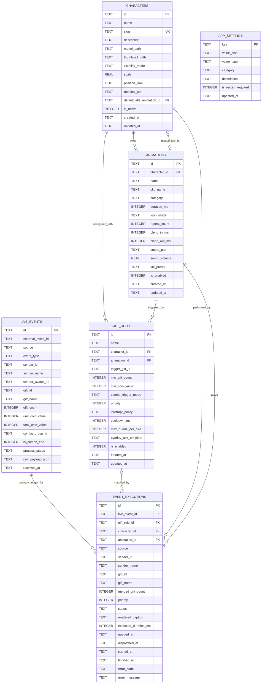

# Tài liệu Mô hình Dữ liệu — BuddhaLive Studio

> **Phiên bản:** 1.3.0 (Cột mốc S5: Bổ sung trạng thái SKIPPED_BY_MANAGER, CLEARED_BY_MANAGER, cấu hình engine.queue_paused & ranh giới LivePlatformAdapter)  
> **Hệ quản trị CSDL:** SQLite 3 (`better-sqlite3`, kiểm chứng đóng gói cùng Electron ngay tại Cột mốc `S1`)  
> **Vị trí lưu trữ trên Windows 11:** `%APPDATA%\BuddhaLiveStudio\data\buddhalive.db`

---

## 1. Nguyên tắc Thiết kế Dữ liệu & Tách Bạch 3 Khái Niệm Cốt Lõi

1. **`Event` (`live_events`):** Sự kiện đầu vào bất biến. Ràng buộc **`UNIQUE(source, external_event_id)` của SQLite là nguồn xác nhận cuối cùng (Final Source of Truth)** cho cơ chế chống xử lý trùng.
2. **`Rule` (`gift_rules`):** Quy tắc cấu hình tĩnh quyết định điều kiện khớp theo `trigger_gift_id`/xu, cửa sổ gộp combo cố định `1500ms` và chính sách ưu tiên.
3. **`Execution` (`event_executions`):** Một lượt xuất hiện thực tế trên Live Overlay. Giới hạn hàng đợi `30` lượt và cơ chế chống đói **chỉ tính trên các bản ghi có `status = 'QUEUED'`**.

### Cấu hình SQLite PRAGMA Bắt buộc
```sql
PRAGMA journal_mode = WAL;          -- Đọc/ghi nhanh, an toàn khi tắt ứng dụng đột ngột
PRAGMA synchronous = NORMAL;        -- Tối ưu tốc độ ghi sự kiện thời gian thực
PRAGMA foreign_keys = ON;           -- Đảm bảo toàn vẹn tham chiếu
PRAGMA busy_timeout = 5000;         -- Tránh lỗi khóa ghi tức thời
```

> **Nguyên tắc Bảo mật Dữ liệu:** Không lưu mật khẩu, `managerToken` hay plain-text `overlayToken` trong bất kỳ bảng SQLite nào. Bản băm `SHA-256` của các phiên `overlayToken` được lưu tách riêng tại `%APPDATA%\BuddhaLiveStudio\security\overlay-sessions.dat` mã hóa qua Windows DPAPI (`electron.safeStorage`).

---

## 2. Sơ đồ Quan hệ Thực thể (ER Diagram)



---

## 3. Đặc tả Chi tiết 6 Thực thể

### 3.1. `Character` (Bảng `characters`)

| Cột | Kiểu SQLite | Ràng buộc | Mô tả |
| :--- | :--- | :--- | :--- |
| `id` | `TEXT` | `PRIMARY KEY` | UUID v4 định danh nhân vật. |
| `name` | `TEXT` | `NOT NULL` | Tên hiển thị nhân vật. |
| `slug` | `TEXT` | `NOT NULL UNIQUE` | Mã định danh không dấu. |
| `description` | `TEXT` | `NULL` | Mô tả nhân vật. |
| `model_path` | `TEXT` | `NOT NULL` | Đường dẫn tương đối tới tệp `<uuid>.glb` trong thư mục `assets/`. |
| `thumbnail_path` | `TEXT` | `NULL` | Ảnh xem trước nhân vật. |
| `visibility_mode` | `TEXT` | `NOT NULL DEFAULT 'APPEAR_ON_EVENT' CHECK (visibility_mode IN ('APPEAR_ON_EVENT','PERSISTENT_IDLE'))` | **`APPEAR_ON_EVENT` (Mặc định):** Có quà mới hiện nhân vật → chạy hoạt ảnh → biến mất. **`PERSISTENT_IDLE`:** Đứng thường trực ở trạng thái nghỉ. |
| `scale` | `REAL` | `NOT NULL DEFAULT 1.0 CHECK (scale > 0)` | Tỉ lệ kích thước 3D. |
| `position_json` / `rotation_json` | `TEXT` | `NOT NULL DEFAULT '{"x":0,"y":0,"z":0}'` | Tọa độ và góc xoay `{ x, y, z }`. |
| `default_idle_animation_id` | `TEXT` | `NULL REFERENCES animations(id) ON DELETE SET NULL` | Chỉ bắt buộc khi `visibility_mode = 'PERSISTENT_IDLE'` (Repository kiểm tra thuộc đúng nhân vật). |
| `is_active` | `INTEGER` | `NOT NULL DEFAULT 0 CHECK (is_active IN (0, 1))` | Tối đa 1 dòng bằng `1` nhờ Partial Unique Index. |
| `created_at` / `updated_at` | `TEXT` | `NOT NULL` | Dấu thời gian ISO-8601. |

---

### 3.2. `Animation` (Bảng `animations`)

| Cột | Kiểu SQLite | Ràng buộc | Mô tả |
| :--- | :--- | :--- | :--- |
| `id` | `TEXT` | `PRIMARY KEY` | UUID v4 định danh hoạt ảnh. |
| `character_id` | `TEXT` | `NOT NULL REFERENCES characters(id) ON DELETE CASCADE` | Nhân vật sở hữu clip hoạt ảnh này. |
| `name` | `TEXT` | `NOT NULL` | Tên hiển thị hoạt ảnh. |
| `clip_name` | `TEXT` | `NOT NULL` | Tên chính xác của `AnimationClip` trong tệp `.glb`. |
| `category` | `TEXT` | `NOT NULL CHECK (category IN ('IDLE','REACTION','SPECIAL','TRANSITION'))` | Phân loại hoạt ảnh. |
| `duration_ms` | `INTEGER` | `NOT NULL CHECK (duration_ms > 0)` | Thời lượng cơ sở của 1 chu kỳ clip (ms). |
| `loop_mode` | `TEXT` | `NOT NULL DEFAULT 'ONCE' CHECK (loop_mode IN ('ONCE','LOOP','REPEAT_N'))` | Chế độ phát. |
| `repeat_count` | `INTEGER` | `NOT NULL DEFAULT 1 CHECK (repeat_count >= 1)` | Số lần lặp khi dùng `REPEAT_N`. |
| `blend_in_ms` / `blend_out_ms` | `INTEGER` | `NOT NULL DEFAULT 250 CHECK (... >= 0)` | Thời gian chuyển mượt (ms). |
| `sound_path` | `TEXT` | `NULL` | Tệp âm thanh đi kèm (tùy chọn). |
| `sound_volume` | `REAL` | `NOT NULL DEFAULT 1.0 CHECK (sound_volume BETWEEN 0.0 AND 1.0)` | Âm lượng riêng của clip. |
| `vfx_preset` | `TEXT` | `NULL` | Hiệu ứng phụ trợ (tùy chọn). |
| `is_enabled` | `INTEGER` | `NOT NULL DEFAULT 1 CHECK (is_enabled IN (0, 1))` | Trạng thái kích hoạt. |
| `created_at` / `updated_at` | `TEXT` | `NOT NULL` | Dấu thời gian ISO-8601. |

---

### 3.3. `GiftRule` — Quy tắc (`Rule`, Bảng `gift_rules`)

| Cột | Kiểu SQLite | Ràng buộc | Mô tả |
| :--- | :--- | :--- | :--- |
| `id` | `TEXT` | `PRIMARY KEY` | UUID v4 định danh quy tắc (`matched_rule_id`). |
| `name` | `TEXT` | `NOT NULL` | Tên quy tắc. |
| `character_id` | `TEXT` | `NOT NULL REFERENCES characters(id) ON DELETE CASCADE` | Nhân vật xuất hiện khi khớp quy tắc. |
| `animation_id` | `TEXT` | `NOT NULL REFERENCES animations(id) ON DELETE RESTRICT` | Hoạt ảnh thực thi (chặn xóa nhầm; Repository kiểm tra cùng `character_id`). |
| `trigger_gift_id` | `TEXT` | `NULL` | Mã định danh quà chuẩn hóa (`'rose'`, `'lotus'`, `'lion'`). `NULL` là quy tắc đại diện theo ngưỡng xu. |
| `min_gift_count` | `INTEGER` | `NOT NULL DEFAULT 1 CHECK (min_gift_count >= 1)` | Số lượng quà tối thiểu. |
| `min_coin_value` | `INTEGER` | `NOT NULL DEFAULT 0 CHECK (min_coin_value >= 0)` | Tổng giá trị xu tối thiểu. |
| `combo_trigger_mode` | `TEXT` | `NOT NULL DEFAULT 'COMBO_MERGE' CHECK (combo_trigger_mode IN ('COMBO_MERGE','THRESHOLD_STEP','EACH_EVENT'))` | **`COMBO_MERGE` (Mặc định):** Gộp trong **cửa sổ cố định `1500ms` tính từ Event đầu tiên** theo khóa `(source, sender_id, gift_id, matched_rule_id)`.<br>**`THRESHOLD_STEP`:** Phát theo bậc `min_gift_count`.<br>**`EACH_EVENT`:** Mỗi sự kiện tạo 1 lượt riêng. |
| `priority` | `INTEGER` | `NOT NULL DEFAULT 10 CHECK (priority BETWEEN 1 AND 100)` | Độ ưu tiên (`100` cao nhất). |
| `interrupt_policy` | `TEXT` | `NOT NULL DEFAULT 'QUEUE' CHECK (interrupt_policy IN ('QUEUE','PREEMPT_LOWER','DROP_IF_BUSY'))` | Chính sách khi nhân vật đang chạy hoạt ảnh. |
| `cooldown_ms` | `INTEGER` | `NOT NULL DEFAULT 0 CHECK (cooldown_ms >= 0)` | Thời gian hồi giữa 2 lần kích hoạt cùng quy tắc. |
| `max_queue_per_rule` | `INTEGER` | `NOT NULL DEFAULT 5 CHECK (max_queue_per_rule >= 1)` | Ngưỡng số lượt `QUEUED` tối đa của quy tắc này trước khi kích hoạt `COALESCE`. |
| `overlay_text_template` | `TEXT` | `NOT NULL DEFAULT '{senderName} đã tặng {giftCount}x {giftName}'` | Mẫu câu hiển thị tên người tặng. |
| `is_enabled` | `INTEGER` | `NOT NULL DEFAULT 1 CHECK (is_enabled IN (0, 1))` | Bật/tắt quy tắc. |
| `created_at` / `updated_at` | `TEXT` | `NOT NULL` | Dấu thời gian ISO-8601. |

---

### 3.4. `LiveEvent` — Sự kiện Đầu vào (`Event`, Bảng `live_events`)

| Cột | Kiểu SQLite | Ràng buộc | Mô tả |
| :--- | :--- | :--- | :--- |
| `id` | `TEXT` | `PRIMARY KEY` | UUID v4 nội bộ của sự kiện. |
| `external_event_id` | `TEXT` | `NULL CHECK (external_event_id IS NULL OR length(trim(external_event_id)) > 0)` | Định danh sự kiện từ nguồn phát. Chuỗi rỗng `""` hoặc toàn khoảng trắng bắt buộc chuẩn hóa về `NULL` trước khi ghi. |
| `source` | `TEXT` | `NOT NULL CHECK (source IN ('DEMO','TIKTOK','SYSTEM'))` | Nguồn phát sự kiện. |
| `event_type` | `TEXT` | `NOT NULL CHECK (event_type IN ('GIFT','LIKE','CHAT','FOLLOW','SHARE'))` | Loại sự kiện. |
| `sender_id` | `TEXT` | `NOT NULL` | Mã định danh người tặng. |
| `sender_name` | `TEXT` | `NOT NULL` | Tên hiển thị của người tặng quà. |
| `sender_avatar_url` | `TEXT` | `NULL` | Ảnh đại diện người tặng (tùy chọn). |
| `gift_id` / `gift_name` | `TEXT` | `NULL` | Mã định danh quà chuẩn hóa (`gift_id`) và tên hiển thị món quà. |
| `gift_count` | `INTEGER` | `NOT NULL DEFAULT 1 CHECK (gift_count >= 1)` | Số lượng quà của gói sự kiện này. |
| `unit_coin_value` / `total_coin_value` | `INTEGER` | `NOT NULL DEFAULT 0 CHECK (... >= 0)` | Đơn giá xu và tổng xu của gói sự kiện. |
| `combo_group_id` | `TEXT` | `NULL` | Mã nhóm chuỗi gửi liên tục từ nguồn phát (nếu có). |
| `is_combo_end` | `INTEGER` | `NOT NULL DEFAULT 1 CHECK (is_combo_end IN (0, 1))` | `1` nếu là sự kiện lẻ hoặc gói chốt chuỗi từ nguồn phát. |
| `process_status` | `TEXT` | `NOT NULL` | `'RECEIVED'`, `'MATCHED'`, `'COALESCED_INTO_QUEUE'`, `'IGNORED_COMBO_BUFFERING'`, `'IGNORED_NO_RULE'`, `'IGNORED_COOLDOWN'`, `'DROPPED_BUSY'`, `'DROPPED_QUEUE_FULL'`. |
| `raw_payload_json` | `TEXT` | `NOT NULL` | JSON gốc đã lọc sạch dữ liệu xác thực nhạy cảm. |
| `received_at` | `TEXT` | `NOT NULL` | Thời điểm tiếp nhận (ISO-8601). |

#### Quy tắc Chống Trùng Lặp & Xử lý `external_event_id NULL`
1. **SQLite `UNIQUE(source, external_event_id)` là nguồn xác nhận cuối cùng:** Bộ nhớ đệm LRU trong RAM chỉ đóng vai trò lọc sớm cho các `external_event_id IS NOT NULL`. Quyết định cuối cùng thuộc về câu lệnh nguyên tử `INSERT INTO live_events ... ON CONFLICT(source, external_event_id) DO NOTHING`: nếu `changes === 0`, sự kiện chắc chắn bị trùng → dừng ngay, không tạo `Execution`.
2. **Trường hợp `external_event_id` là `NULL` (hoặc chuỗi rỗng):**
   - Tầng tiếp nhận `EventIngressPort` chuyển mọi giá trị `undefined`, `null`, `""` hoặc chuỗi chỉ gồm khoảng trắng về đúng giá trị `NULL` (kết hợp ràng buộc `CHECK` chặn chuỗi rỗng trong SQLite để không bao giờ gộp nhầm hai sự kiện chuỗi rỗng `""` là trùng nhau).
   - Khi `external_event_id IS NULL`: **bỏ qua bộ đệm LRU** và chèn thẳng vào SQLite. Theo chuẩn SQL của SQLite, các giá trị `NULL` trong cột `UNIQUE(source, external_event_id)` được coi là độc lập nhau, do đó sự kiện không có mã định danh nguồn vẫn được lưu vết và xử lý an toàn đúng 1 lần mà không văng lỗi hay chặn sự kiện kế tiếp. *(Riêng `DemoSimulator` mặc định luôn sinh `demo_<uuid>` để hỗ trợ kiểm thử gửi lặp có chủ đích)*.

---

### 3.5. `EventExecution` — Lượt Thực thi Hành động (`Execution`, Bảng `event_executions`)

| Cột | Kiểu SQLite | Ràng buộc | Mô tả |
| :--- | :--- | :--- | :--- |
| `id` | `TEXT` | `PRIMARY KEY` | UUID v4 định danh lượt xuất hiện (`executionId`). |
| `live_event_id` | `TEXT` | `NOT NULL REFERENCES live_events(id) ON DELETE CASCADE` | Sự kiện đầu tiên khởi tạo lượt thực thi này. |
| `gift_rule_id` | `TEXT` | `NULL REFERENCES gift_rules(id) ON DELETE SET NULL` | Quy tắc đã khớp (`NULL` nếu là lệnh Xem thử Preview). |
| `character_id` | `TEXT` | `NOT NULL REFERENCES characters(id) ON DELETE CASCADE` | Nhân vật thực hiện. |
| `animation_id` | `TEXT` | `NOT NULL REFERENCES animations(id) ON DELETE CASCADE` | Hoạt ảnh thực hiện. |
| `source` | `TEXT` | `NOT NULL CHECK (source IN ('DEMO','TIKTOK','SYSTEM'))` | Nguồn phát (phục vụ đối chiếu trực tiếp khóa `COALESCE`). |
| `sender_id` / `sender_name` | `TEXT` | `NOT NULL` | Định danh (cho khóa `COALESCE`) và tên hiển thị người tặng trên Overlay. |
| `gift_id` / `gift_name` | `TEXT` | `NULL` | Mã quà (cho khóa `COALESCE`) và tên món quà hiển thị. |
| `merged_gift_count` | `INTEGER` | `NOT NULL DEFAULT 1 CHECK (merged_gift_count >= 1)` | Tổng số lượng quà của lượt xuất hiện (cộng dồn qua `COMBO_MERGE` hoặc `COALESCE`). |
| `priority` | `INTEGER` | `NOT NULL` | Độ ưu tiên thực thi (`1..100`). |
| `status` | `TEXT` | `NOT NULL` | Một trong 12 trạng thái chuẩn: `'QUEUED'`, `'DISPATCHED'`, `'PLAYING'`, `'COMPLETED'`, **`'COMPLETED_WITH_FALLBACK'`**, `'PREEMPTED'`, **`'EVICTED_BY_PRIORITY'`**, `'TIMED_OUT'`, `'FAILED'`, `'CANCELLED'`, **`'SKIPPED_BY_MANAGER'`**, **`'CLEARED_BY_MANAGER'`**. |
| `rendered_caption` | `TEXT` | `NOT NULL` | Chuỗi thông điệp hoàn chỉnh hiển thị kèm tên người tặng. |
| `expected_duration_ms` | `INTEGER` | `NOT NULL CHECK (expected_duration_ms > 0)` | Thời lượng dự kiến của lượt xuất hiện. |
| `queued_at` / `dispatched_at` / `started_at` / `finished_at` | `TEXT` | `queued_at NOT NULL`, còn lại `NULL` | Dấu thời gian từng chặng vòng đời. |
| `error_code` / `error_message` | `TEXT` | `NULL` | Lưu nguyên nhân lỗi hoặc lý do hủy/bỏ qua (`'MODEL_LOAD_FAILED'`, `'CLIP_NOT_FOUND'`, `'WEBGL_LOST'`, `'OVERLAY_RELOADED'`, `'ACK_TIMEOUT'`, `'SERVER_RESTARTED'`, `'SKIPPED_BY_MANAGER'`, `'CLEARED_BY_MANAGER'`). |

---

### 3.6. `AppSetting` (Bảng `app_settings` — Cấu hình Vận hành Phi nhạy cảm)

| `key` | Giá trị mặc định (`value_json`) | `value_type` | `category` | Ý nghĩa vận hành |
| :--- | :--- | :--- | :--- | :--- |
| `server.host` | `"127.0.0.1"` | `STRING` | `SERVER` | Khóa cứng địa chỉ loopback an toàn. |
| `server.port` | `3721` | `NUMBER` | `SERVER` | Cổng cục bộ của Backend. |
| `engine.combo_window_ms` | `1500` | `NUMBER` | `ENGINE` | **Cửa sổ cố định `1500ms` tính từ Event đầu tiên** cho chế độ `COMBO_MERGE`. |
| `engine.min_display_protection_ms` | `1000` | `NUMBER` | `ENGINE` | Thời gian hiển thị tối thiểu trước khi cho phép quà VIP thay thế (`PREEMPT_LOWER`). |
| `engine.max_queue_size` | `30` | `NUMBER` | `ENGINE` | Số lượng bản ghi `status = 'QUEUED'` tối đa trong hàng đợi. |
| `engine.start_ack_timeout_ms` | `2000` | `NUMBER` | `ENGINE` | Hạn chờ xác nhận bắt đầu từ Overlay. |
| `engine.completion_buffer_ms` | `3000` | `NUMBER` | `ENGINE` | Khoảng đệm cộng thêm trước khi Watchdog cắt `TIMED_OUT`. |
| `engine.queue_paused` | `false` | `BOOLEAN` | `ENGINE` | Trạng thái tạm dừng điều phối hàng đợi (`PAUSE` / `RESUME`), duy trì qua restart. |
| `overlay.fps_limit` | `60` | `NUMBER` | `OVERLAY` | Giới hạn FPS khung hình 3D (`30` hoặc `60`). |
| `overlay.fallback_2d_alert` | `true` | `BOOLEAN` | `OVERLAY` | Hiện bảng vinh danh 2D khi model 3D lỗi (trả về `COMPLETED_WITH_FALLBACK`). |
| `overlay.show_demo_badge` | `true` | `BOOLEAN` | `DEMO` | Hiện nhãn `DEMO` góc nhỏ khi chạy sự kiện mô phỏng. |
| `audio.master_volume` | `0.85` | `NUMBER` | `AUDIO` | Âm lượng tổng trên Overlay (`0.0` → `1.0`). |
| `retention.events_days` | `14` | `NUMBER` | `RETENTION` | Số ngày lưu lịch sử sự kiện trước khi tự động dọn dẹp. |

---

## 4. Lược đồ SQL Khởi tạo Chuẩn (`001_initial_schema.sql`)

```sql
CREATE TABLE IF NOT EXISTS characters (
    id TEXT PRIMARY KEY,
    name TEXT NOT NULL,
    slug TEXT NOT NULL UNIQUE,
    description TEXT,
    model_path TEXT NOT NULL,
    thumbnail_path TEXT,
    visibility_mode TEXT NOT NULL DEFAULT 'APPEAR_ON_EVENT'
        CHECK (visibility_mode IN ('APPEAR_ON_EVENT', 'PERSISTENT_IDLE')),
    scale REAL NOT NULL DEFAULT 1.0 CHECK (scale > 0),
    position_json TEXT NOT NULL DEFAULT '{"x":0,"y":0,"z":0}',
    rotation_json TEXT NOT NULL DEFAULT '{"x":0,"y":0,"z":0}',
    default_idle_animation_id TEXT,
    is_active INTEGER NOT NULL DEFAULT 0 CHECK (is_active IN (0, 1)),
    created_at TEXT NOT NULL,
    updated_at TEXT NOT NULL,
    FOREIGN KEY (default_idle_animation_id) REFERENCES animations(id) ON DELETE SET NULL
);

CREATE UNIQUE INDEX IF NOT EXISTS idx_characters_single_active
    ON characters(is_active) WHERE is_active = 1;

CREATE TABLE IF NOT EXISTS animations (
    id TEXT PRIMARY KEY,
    character_id TEXT NOT NULL,
    name TEXT NOT NULL,
    clip_name TEXT NOT NULL,
    category TEXT NOT NULL CHECK (category IN ('IDLE', 'REACTION', 'SPECIAL', 'TRANSITION')),
    duration_ms INTEGER NOT NULL CHECK (duration_ms > 0),
    loop_mode TEXT NOT NULL DEFAULT 'ONCE' CHECK (loop_mode IN ('ONCE', 'LOOP', 'REPEAT_N')),
    repeat_count INTEGER NOT NULL DEFAULT 1 CHECK (repeat_count >= 1),
    blend_in_ms INTEGER NOT NULL DEFAULT 250 CHECK (blend_in_ms >= 0),
    blend_out_ms INTEGER NOT NULL DEFAULT 250 CHECK (blend_out_ms >= 0),
    sound_path TEXT,
    sound_volume REAL NOT NULL DEFAULT 1.0 CHECK (sound_volume >= 0.0 AND sound_volume <= 1.0),
    vfx_preset TEXT,
    is_enabled INTEGER NOT NULL DEFAULT 1 CHECK (is_enabled IN (0, 1)),
    created_at TEXT NOT NULL,
    updated_at TEXT NOT NULL,
    UNIQUE (character_id, clip_name, name),
    FOREIGN KEY (character_id) REFERENCES characters(id) ON DELETE CASCADE
);

CREATE INDEX IF NOT EXISTS idx_animations_character
    ON animations(character_id, is_enabled);

CREATE TABLE IF NOT EXISTS gift_rules (
    id TEXT PRIMARY KEY,
    name TEXT NOT NULL,
    character_id TEXT NOT NULL,
    animation_id TEXT NOT NULL,
    trigger_gift_id TEXT,
    min_gift_count INTEGER NOT NULL DEFAULT 1 CHECK (min_gift_count >= 1),
    min_coin_value INTEGER NOT NULL DEFAULT 0 CHECK (min_coin_value >= 0),
    combo_trigger_mode TEXT NOT NULL DEFAULT 'COMBO_MERGE'
        CHECK (combo_trigger_mode IN ('COMBO_MERGE', 'THRESHOLD_STEP', 'EACH_EVENT')),
    priority INTEGER NOT NULL DEFAULT 10 CHECK (priority BETWEEN 1 AND 100),
    interrupt_policy TEXT NOT NULL DEFAULT 'QUEUE'
        CHECK (interrupt_policy IN ('QUEUE', 'PREEMPT_LOWER', 'DROP_IF_BUSY')),
    cooldown_ms INTEGER NOT NULL DEFAULT 0 CHECK (cooldown_ms >= 0),
    max_queue_per_rule INTEGER NOT NULL DEFAULT 5 CHECK (max_queue_per_rule >= 1),
    overlay_text_template TEXT NOT NULL DEFAULT '{senderName} đã tặng {giftCount}x {giftName}',
    is_enabled INTEGER NOT NULL DEFAULT 1 CHECK (is_enabled IN (0, 1)),
    created_at TEXT NOT NULL,
    updated_at TEXT NOT NULL,
    FOREIGN KEY (character_id) REFERENCES characters(id) ON DELETE CASCADE,
    FOREIGN KEY (animation_id) REFERENCES animations(id) ON DELETE RESTRICT
);

CREATE INDEX IF NOT EXISTS idx_gift_rules_matching
    ON gift_rules(character_id, is_enabled, trigger_gift_id, priority DESC);

CREATE TABLE IF NOT EXISTS live_events (
    id TEXT PRIMARY KEY,
    external_event_id TEXT
        CHECK (external_event_id IS NULL OR length(trim(external_event_id)) > 0),
    source TEXT NOT NULL CHECK (source IN ('DEMO', 'TIKTOK', 'SYSTEM')),
    event_type TEXT NOT NULL CHECK (event_type IN ('GIFT', 'LIKE', 'CHAT', 'FOLLOW', 'SHARE')),
    sender_id TEXT NOT NULL,
    sender_name TEXT NOT NULL,
    sender_avatar_url TEXT,
    gift_id TEXT,
    gift_name TEXT,
    gift_count INTEGER NOT NULL DEFAULT 1 CHECK (gift_count >= 1),
    unit_coin_value INTEGER NOT NULL DEFAULT 0 CHECK (unit_coin_value >= 0),
    total_coin_value INTEGER NOT NULL DEFAULT 0 CHECK (total_coin_value >= 0),
    combo_group_id TEXT,
    is_combo_end INTEGER NOT NULL DEFAULT 1 CHECK (is_combo_end IN (0, 1)),
    process_status TEXT NOT NULL
        CHECK (process_status IN (
            'RECEIVED', 'MATCHED', 'COALESCED_INTO_QUEUE',
            'IGNORED_COMBO_BUFFERING', 'IGNORED_NO_RULE', 'IGNORED_COOLDOWN',
            'DROPPED_BUSY', 'DROPPED_QUEUE_FULL'
        )),
    raw_payload_json TEXT NOT NULL,
    received_at TEXT NOT NULL,
    UNIQUE (source, external_event_id)
);

CREATE INDEX IF NOT EXISTS idx_live_events_received_at
    ON live_events(received_at DESC);

CREATE TABLE IF NOT EXISTS event_executions (
    id TEXT PRIMARY KEY,
    live_event_id TEXT NOT NULL,
    gift_rule_id TEXT,
    character_id TEXT NOT NULL,
    animation_id TEXT NOT NULL,
    source TEXT NOT NULL CHECK (source IN ('DEMO', 'TIKTOK', 'SYSTEM')),
    sender_id TEXT NOT NULL,
    sender_name TEXT NOT NULL,
    gift_id TEXT,
    gift_name TEXT,
    merged_gift_count INTEGER NOT NULL DEFAULT 1 CHECK (merged_gift_count >= 1),
    priority INTEGER NOT NULL,
    status TEXT NOT NULL
        CHECK (status IN (
            'QUEUED', 'DISPATCHED', 'PLAYING',
            'COMPLETED', 'COMPLETED_WITH_FALLBACK',
            'PREEMPTED', 'EVICTED_BY_PRIORITY',
            'TIMED_OUT', 'FAILED', 'CANCELLED',
            'SKIPPED_BY_MANAGER', 'CLEARED_BY_MANAGER'
        )),
    rendered_caption TEXT NOT NULL,
    expected_duration_ms INTEGER NOT NULL CHECK (expected_duration_ms > 0),
    queued_at TEXT NOT NULL,
    dispatched_at TEXT,
    started_at TEXT,
    finished_at TEXT,
    error_code TEXT,
    error_message TEXT,
    FOREIGN KEY (live_event_id) REFERENCES live_events(id) ON DELETE CASCADE,
    FOREIGN KEY (gift_rule_id) REFERENCES gift_rules(id) ON DELETE SET NULL,
    FOREIGN KEY (character_id) REFERENCES characters(id) ON DELETE CASCADE,
    FOREIGN KEY (animation_id) REFERENCES animations(id) ON DELETE CASCADE
);

CREATE INDEX IF NOT EXISTS idx_event_executions_status_queue
    ON event_executions(status, priority DESC, queued_at ASC);

CREATE INDEX IF NOT EXISTS idx_event_executions_coalesce
    ON event_executions(status, gift_rule_id, source, sender_id, gift_id);

CREATE INDEX IF NOT EXISTS idx_event_executions_live_event_id
    ON event_executions(live_event_id);

CREATE TABLE IF NOT EXISTS app_settings (
    key TEXT PRIMARY KEY,
    value_json TEXT NOT NULL,
    value_type TEXT NOT NULL CHECK (value_type IN ('STRING', 'NUMBER', 'BOOLEAN', 'JSON')),
    category TEXT NOT NULL CHECK (category IN ('SERVER', 'OVERLAY', 'ENGINE', 'AUDIO', 'DEMO', 'RETENTION')),
    description TEXT NOT NULL,
    is_restart_required INTEGER NOT NULL DEFAULT 0 CHECK (is_restart_required IN (0, 1)),
    updated_at TEXT NOT NULL
);
```
