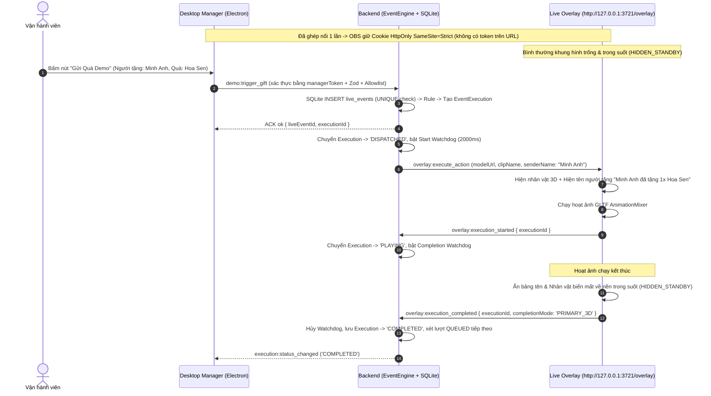
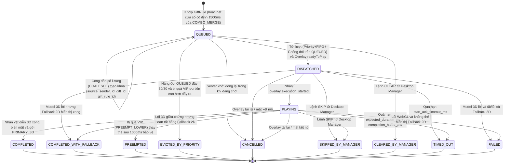
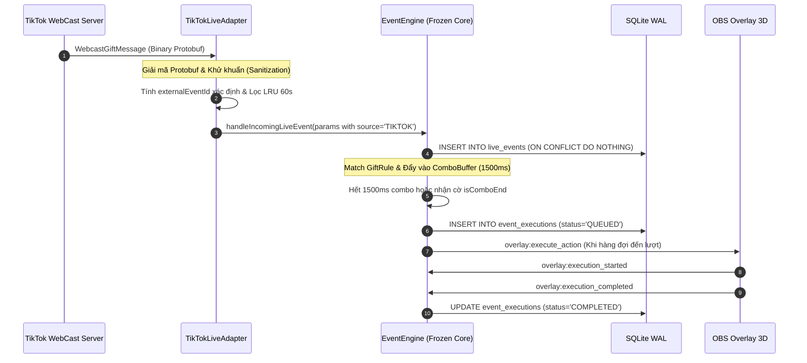

# Giao thức Socket.IO & Quy định Xử lý Sự kiện Quà tặng — BuddhaLive Studio

> **Phiên bản:** 1.4.0 (Cột mốc S7: Bổ sung Luồng Tiếp nhận Sự kiện TikTok LIVE & Đặc tả NormalizedLiveEvent)  
> **Giao thức Realtime:** Socket.IO v4 trên `ws://127.0.0.1:3721/socket.io`

---

## 1. Giao thức Socket.IO, Xác thực Không Dùng Query String & Bảo vệ Thông điệp

### 1.1. Quy trình Xác thực Bắt tay theo Loại Client

**Nguyên tắc bảo mật cốt lõi:** Tuyệt đối **không truyền `overlayToken` (hay bất kỳ token nào) trên URL query string** và **không bao giờ ghi token vào log**. Nếu yêu cầu HTTP/WebSocket chứa `?token=` hoặc `?overlayToken=` trên URL, máy chủ từ chối ngay với `400 TOKEN_IN_QUERY_FORBIDDEN`.

```ts
type SocketHandshakeAuth =
  | {
      protocolVersion: '1.0';
      clientType: 'MANAGER';
      token: string; // managerToken nhận trực tiếp từ Electron preload (trong RAM)
      instanceId: string;
    }
  | {
      protocolVersion: '1.0';
      clientType: 'OVERLAY';
      instanceId: string;
      // Không truyền overlayToken trên URL; trình duyệt CEF của OBS tự gửi Cookie
      // HttpOnly; SameSite=Strict ("bls_overlay_session") trong HTTP Upgrade header!
    };
```

1. **Với `MANAGER` (Desktop Manager):**
   - Kiểm tra `Host`, `Origin` nội bộ và đối chiếu hằng số thời gian `auth.token` với `managerToken` sinh trong RAM của phiên Electron → đưa vào **`room:managers`**.
2. **Với `OVERLAY` (OBS Browser Source mở `http://127.0.0.1:3721/overlay`):**
   - Kiểm tra `Host` (chặn DNS Rebinding) và từ chối nếu `Origin` là tên miền website ngoài.
   - Đọc cookie `bls_overlay_session` (`HttpOnly; SameSite=Strict`) từ header `Cookie` của yêu cầu nâng cấp kết nối, băm `SHA-256` và đối chiếu với danh sách phiên hợp lệ đã giải mã từ kho DPAPI (`overlay-sessions.dat`) → nếu hợp lệ đưa vào **`room:overlays`**.
   - Nếu chưa ghép nối (chưa có cookie hoặc phiên đã bị thu hồi), từ chối bắt tay Socket.IO với mã `OVERLAY_PAIRING_REQUIRED` để giao diện `/overlay` hiển thị mã đối chiếu 6 chữ số chờ vận hành viên bấm duyệt trên Desktop Manager.

### 1.2. Message Allowlist, Zod Validation & Rate Limiting

Mọi gói tin qua Socket.IO bắt buộc bọc trong `SocketEnvelope<T>` (`maxHttpBufferSize = 64KB`) và đi qua 3 cổng kiểm soát:
1. **Allowlist cứng theo vai trò:**
   - `MANAGER_EVENT_ALLOWLIST`: `['demo:trigger_gift', 'demo:run_scenario', 'demo:stop_scenario', 'queue:control', 'character:upsert', 'character:set_active', 'character:delete', 'animation:upsert', 'animation:delete', 'animation:preview', 'rule:upsert', 'rule:toggle', 'rule:delete', 'settings:update', 'security:approve_overlay_pair', 'security:revoke_overlay_sessions']`.
   - `OVERLAY_EVENT_ALLOWLIST`: `['overlay:telemetry', 'overlay:execution_started', 'overlay:execution_completed', 'overlay:execution_failed']`.
   - Gửi sự kiện ngoài danh sách của vai trò mình lập tức bị chặn với mã `FORBIDDEN_ROLE` hoặc `EVENT_NOT_ALLOWED`.
2. **Zod Schema Validation (`.strict()`):** Từ chối mọi payload sai kiểu, vượt giới hạn độ dài chuỗi hoặc chứa trường lạ (`VALIDATION_ERROR`).
3. **Rate Limiting theo kết nối:** Chặn tràn gói tin trên từng socket (ví dụ: lệnh cấu hình `30 gói/phút`, báo cáo `overlay:telemetry`/ACK `30 gói/giây`, yêu cầu ghép nối HTTP `10 lần/phút`), trả về `RATE_LIMITED`.

```ts
type SocketAck<TData = void> =
  | { ok: true; data: TData }
  | {
      ok: false;
      error: {
        code:
          | 'UNAUTHORIZED'
          | 'OVERLAY_PAIRING_REQUIRED'
          | 'FORBIDDEN_ROLE'
          | 'EVENT_NOT_ALLOWED'
          | 'RATE_LIMITED'
          | 'VALIDATION_ERROR'
          | 'NOT_FOUND'
          | 'CONFLICT'
          | 'INTERNAL_ERROR';
        message: string;
      };
    };
```

### 1.3. Payload Hoàn tất Lượt Thực thi (Hỗ trợ `COMPLETED_WITH_FALLBACK`)

```ts
interface OverlayExecutionCompletedPayload {
  executionId: string;
  completionMode: 'PRIMARY_3D' | 'FALLBACK_2D';
  actualDurationMs: number;
  fallbackReasonCode?: 'MODEL_LOAD_FAILED' | 'CLIP_NOT_FOUND' | 'WEBGL_LOST';
  fallbackReasonMessage?: string;
}
```
- Khi `completionMode === 'PRIMARY_3D'` → Backend lưu `EventExecution.status = 'COMPLETED'`.
- Khi `completionMode === 'FALLBACK_2D'` (model 3D lỗi nhưng bảng thông báo 2D đã hiển thị thành công tên người tặng + món quà) → Backend lưu `EventExecution.status = 'COMPLETED_WITH_FALLBACK'` kèm `error_code = fallbackReasonCode` để cảnh báo sửa model trên Desktop Manager mà **không đánh dấu toàn bộ lượt thực thi là `FAILED`**.
- Sự kiện `overlay:execution_failed` chỉ dùng khi model 3D lỗi **và** fallback 2D bị tắt (`fallback_2d_alert = false`) hoặc bản thân việc hiển thị fallback cũng thất bại → khi đó mới ghi `status = 'FAILED'`.

### 1.4. Lệnh Điều khiển Hàng đợi `queue:control` (Cột mốc S5)

```ts
interface QueueControlPayload {
  action: 'PAUSE' | 'RESUME' | 'SKIP' | 'CLEAR';
  reason?: string;
}
```
- **`PAUSE`:** Dừng dispatch Execution mới từ Queue; lượt `PLAYING` hiện tại được diễn hết thời lượng tự nhiên. Trạng thái lưu bền vững trong SQLite `app_settings` (`engine.queue_paused = true`), duy trì an toàn qua restart.
- **`RESUME`:** Tiếp tục dispatch hàng đợi theo `priority DESC` + `FIFO`. Lưu `engine.queue_paused = false`.
- **`SKIP`:** Hủy lượt đang `PLAYING` (hoặc `DISPATCHED`) với trạng thái **`SKIPPED_BY_MANAGER`**, `error_code = 'SKIPPED_BY_MANAGER'`, gửi `overlay:cancel_action` để Overlay ẩn ngay nhân vật về trong suốt, đồng thời tự động phát tiếp lượt kế tiếp (nếu không paused).
- **`CLEAR`:** Hủy toàn bộ các lượt đang `QUEUED` với trạng thái **`CLEARED_BY_MANAGER`**, `error_code = 'CLEARED_BY_MANAGER'`. **Giữ nguyên lượt đang `PLAYING`**. Trả về số lượng bản ghi bị hủy.
- Cả 4 lệnh điều khiển đều phát sóng cập nhật `ManagerStateSnapshot` tới mọi Desktop Manager qua `room:managers` theo thời gian thực (không cần F5).

---

## 2. Quy định Chính thức Xử lý 7 Tình Huống Quà tặng Thực tế

| # | Tình huống thực tế | Quy định xử lý chính thức (`v1.2.0`) |
| :- | :--- | :--- |
| **1** | **Một người gửi nhiều quà liên tục (`COMBO_MERGE`)** | • Mỗi gói đầu vào vẫn ghi nhận một bản ghi `Event` (`live_events`).<br>• Chế độ mặc định **`COMBO_MERGE`** sử dụng **cửa sổ cố định `1500ms` tính từ `Event` đầu tiên** của chuỗi (`windowExpiresAt = firstEventTime + 1500ms`, không gia hạn/trượt khi có gói tiếp theo vào trong cửa sổ; có thể chốt sớm nếu nguồn phát gửi `is_combo_end = 1`).<br>• **Khóa gộp combo gồm đúng 4 trường:** **`(source, sender_id, gift_id, matched_rule_id)`**.<br>• Khi hết cửa sổ `1500ms`, nếu tổng số lượng và tổng xu tích lũy đạt `min_gift_count` & `min_coin_value`, hệ thống tạo **01 `Execution` tổng hợp** với `merged_gift_count` cộng dồn. |
| **2** | **Nhiều người gửi quà cùng lúc & Chống đói** | • Xếp hàng theo **`priority DESC`, cùng `priority` thì `queued_at ASC` (`FIFO`)**.<br>• **Quy tắc chống đói chỉ áp dụng cho các `Execution` đang ở trạng thái `QUEUED`** (không áp dụng cho sự kiện còn nằm trong bộ đệm combo, không tác động lượt đang `DISPATCHED`/`PLAYING`): sau tối đa **3 lượt ưu tiên cao được rút ra phát liên tiếp**, nếu trong tập `status = 'QUEUED'` có bản ghi đã chờ `>= 30 giây`, hệ thống rút 1 bản ghi `QUEUED` chờ lâu nhất ra phát tiếp theo. |
| **3** | **Nhân vật đang chạy hoạt ảnh** | • **Mặc định (`QUEUE`):** Cho lượt đang diễn chạy hết, quà mới xếp vào `QUEUED`.<br>• **Thay thế có bảo vệ (`PREEMPT_LOWER`):** Chỉ kích hoạt khi quy tắc quà mới đặt `PREEMPT_LOWER`, có `priority` cao hơn lượt đang diễn **và** lượt đang diễn đã hiển thị tối thiểu `1000ms` (`min_display_protection_ms`); lượt cũ chuyển sang `PREEMPTED`.<br>• **`DROP_IF_BUSY`:** Bỏ qua nếu đang có lượt `DISPATCHED`/`PLAYING` (`LiveEvent.process_status = 'DROPPED_BUSY'`). |
| **4** | **Số quà vượt khả năng hiển thị (Trần `30` lượt `QUEUED`, `COALESCE` & `EVICTED_BY_PRIORITY`)** | • **Giới hạn `30` lượt (`max_queue_size = 30`)** và `max_queue_per_rule = 5` đều **chỉ đếm trên các `Execution` có `status = 'QUEUED'`** (không tính lượt đang `DISPATCHED`/`PLAYING`).<br>• **Cộng dồn hàng đợi (`COALESCE`):** Khi số bản ghi `QUEUED` của quy tắc đó đã chạm `max_queue_per_rule` (hoặc tổng `QUEUED` đã chạm `30`), hệ thống tìm bản ghi đang **`QUEUED`** khớp đúng bộ khóa 4 trường **`(source, sender_id, gift_id, gift_rule_id)`**. Nếu tìm thấy, cộng dồn `merged_gift_count`, cập nhật lại `rendered_caption`, giữ nguyên `queued_at` và ghi nhận `LiveEvent.process_status = 'COALESCED_INTO_QUEUE'`.<br>• **Đẩy lùi bởi VIP (`EVICTED_BY_PRIORITY`):** Khi tổng `QUEUED` đã đầy `30/30` và không tìm thấy bản ghi `QUEUED` nào khớp khóa `COALESCE`: nếu `new.priority <= min(QUEUED.priority)` thì từ chối tạo `Execution` (`LiveEvent.process_status = 'DROPPED_QUEUE_FULL'`); nếu `new.priority > min(QUEUED.priority)` thì chọn bản ghi `QUEUED` có `priority` thấp nhất (nếu hòa `priority` thì chọn bản ghi vào muộn nhất `queued_at DESC`), chuyển `Execution.status` của nó sang **`EVICTED_BY_PRIORITY`** (`finished_at = now`) rồi chèn `Execution` VIP mới vào hàng đợi. |
| **5** | **Một sự kiện bị gửi lại & `external_event_id NULL`** | • **SQLite `UNIQUE(source, external_event_id)` là nguồn xác nhận cuối cùng:** Bộ đệm LRU chỉ dùng để lọc nhanh các ID khác `NULL`; phán quyết cuối cùng là câu lệnh SQLite `INSERT ... ON CONFLICT(source, external_event_id) DO NOTHING` (`changes === 0` → dừng ngay, không tạo `Execution` thứ hai).<br>• **Xử lý `external_event_id NULL`:** Chuỗi rỗng `""` hoặc khoảng trắng được chuẩn hóa thành `NULL` ngay ở cửa vào. Khi `external_event_id IS NULL`, sự kiện không đi qua LRU cache và được SQLite chèn như một sự kiện độc lập xử lý đúng 1 lần (không chặn nhầm các sự kiện `NULL` tiếp theo). |
| **6** | **Overlay bị tải lại giữa chừng** | • Nếu cửa sổ Overlay duy nhất bị ngắt/tải lại khi đang có lượt `DISPATCHED`/`PLAYING`, Backend hủy sạch lượt dở đó với `status = 'CANCELLED'` (`error_code = 'OVERLAY_RELOADED'`).<br>• Khi Overlay tải lại xong (xác thực tự động bằng cookie `bls_overlay_session`), nhận `system:state_snapshot` về trạng thái ẩn sạch `HIDDEN_STANDBY` và gửi `overlay:telemetry (readyToPlay: true)`, Backend tự động phát tiếp phần tử `QUEUED` kế tiếp. |
| **7** | **Model 3D bị lỗi (`COMPLETED_WITH_FALLBACK`)** | • Lỗi âm thanh không chặn hình ảnh 3D.<br>• Lỗi tải `.glb`, thiếu `clip_name` hoặc lỗi WebGL: nếu `overlay.fallback_2d_alert = true`, Overlay lập tức hiển thị **bảng vinh danh 2D có tên người tặng + món quà**, sau khi hiển thị xong gửi `overlay:execution_completed (completionMode: 'FALLBACK_2D')` → Backend lưu trạng thái **`COMPLETED_WITH_FALLBACK`** (không đánh dấu `FAILED`), bật cảnh báo sửa model trên Manager và tiếp tục xử lý bình thường các sự kiện tiếp theo. Chỉ ghi `FAILED` khi tắt fallback 2D hoặc cả fallback 2D cũng lỗi. |

---

## 3. Luồng Thử nghiệm Xuyên suốt Đầu tiên (`S2` Walking Skeleton)



---

## 4. Máy Trạng thái Vòng đời `EventExecution` (`v1.3.0`)



---

## 6. Luồng Tiếp nhận Sự kiện TikTok LIVE Thực tế (Cột mốc S7 / S8)

Sự kiện từ TikTok LIVE sau khi được giải mã qua `TikTokLiveAdapter` (Protobuf WebCast v3) sẽ được chuyển thành định dạng `NormalizedLiveEvent` và đi vào `EventEngine` theo đúng đường ống chuẩn mực:



Chi tiết đặc tả ánh xạ trường và máy trạng thái kết nối xem tại [`docs/thiet-ke-kien-truc-tiktok-adapter.md`](file:///d:/toptop_duan/docs/thiet-ke-kien-truc-tiktok-adapter.md).

