# Kế hoạch Triển khai Theo Lát cắt Xuyên suốt — BuddhaLive Studio

> **Phiên bản:** 1.5.0 (Kế hoạch Cột mốc `S6`: MVP Release Candidate — T-16, T-17, T-18, T-19)  
> **Quy tắc Thực thi:** **Phạm vi S1–S5 đã đóng băng.** Tuyệt đối không thay đổi kiến trúc hoặc nghiệp vụ đã nghiệm thu. Không tích hợp TikTok LIVE thật trong S6 (chỉ thực hiện sau khi Release Candidate được nghiệm thu toàn diện).

---

## 1. Sơ đồ Lộ trình 6 Cột mốc Theo Thứ tự Phụ thuộc

```mermaid
flowchart TD
    subgraph S1["Cột mốc S1: Kiểm chứng Sớm Electron + SQLite Đóng gói Windows"]
        T01["T-01: Khởi tạo khung pnpm Monorepo,\nTypeScript Strict, Vitest & Playwright"]
        T02["T-02: Electron tối thiểu mở better-sqlite3 (WAL),\nchạy migration & đọc/ghi trên BẢN ĐÓNG GÓI Windows"]
        T01 --> T02
    end

    subgraph S2["Cột mốc S2: Bản Chạy Thử Xuyên Suốt Đầu Tiên (Walking Skeleton)"]
        T03["T-03: Bảo mật 6 Lớp cho Server 127.0.0.1:3721\n(managerToken RAM, Cookie HttpOnly overlayToken qua Pairing/DPAPI,\nCấm Query Token, Redact Log, Allowlist + Zod + RateLimit)"]
        T04["T-04: Luồng Backend + Socket.IO tối giản\n(1 nhân vật mẫu + 1 loại quà: Event -> Execution -> ACK)"]
        T05["T-05: Live Overlay 3D tại URL sạch /overlay\n(Hiện nhân vật -> Chạy hoạt ảnh + Hiện tên người tặng -> Biến mất)"]
        T06["T-06: Nút bấm Demo + Duyệt Ghép nối trên Electron,\nKiểm chứng chạy thật trên Gói Windows + OBS"]
        T02 --> T03
        T03 --> T04
        T04 --> T05
        T04 --> T06
        T05 --> T06
    end

    subgraph S3["Cột mốc S3: Hoàn thiện Lõi Event - Rule - Execution (7 Tình huống Thực tế)"]
        T07["T-07: Schema 6 Thực thể v1.2.0, SQLite UNIQUE làm nguồn cuối\n& Xử lý chuẩn external_event_id NULL + Crash Recovery"]
        T08["T-08: RuleMatcher Đầy đủ\n(Cửa sổ cố định 1500ms từ Event đầu tiên, khóa 4 trường, Cooldown)"]
        T09["T-09: EventEngine Thực chiến\n(Max 30 QUEUED, COALESCE 4 trường, Chống đói trên QUEUED,\nEVICTED_BY_PRIORITY, COMPLETED_WITH_FALLBACK, Reload & Watchdog)"]
        T06 --> T07
        T07 --> T08
        T08 --> T09
    end

    subgraph S4["Cột mốc S4: Mở rộng Quản lý Đa Nhân vật, Hoạt ảnh & Gift Rule trên Desktop Manager"]
        T10["T-10: Upload GLB/Audio An toàn, Kiểm tra Magic Bytes\n& Trích xuất Danh sách AnimationClip Thực tế từ GLB"]
        T11["T-11: Quản lý Đa Nhân vật (CRUD, Active State,\nPreview & Ràng buộc Xóa Phụ thuộc An toàn)"]
        T12["T-12: Quản lý Hoạt ảnh & Ánh xạ Clip Thực tế\n(Mapping Clip, Thời lượng, Ràng buộc RESTRICT)"]
        T13["T-13: Quản lý Gift Rule & Hoàn thiện Desktop Manager UI\n(CRUD Rule, Điều kiện Quà/Xu/Combo, Không can thiệp PLAYING,\nKiểm tra Crash Combo 1500ms & Smoke Test OBS Đóng gói)"]
        T09 --> T10
        T10 --> T11
        T11 --> T12
        T12 --> T13
    end

    subgraph S5["Cột mốc S5: Demo Đa Kịch bản, Giám sát, Ranh giới TikTok & Nghiệm thu MVP"]
        T14["T-14: Bàn điều khiển Demo Đa Kịch bản\n& Màn hình Giám sát Hàng đợi (PAUSE/RESUME/SKIP/CLEAR)"]
        T15["T-15: Ranh giới LivePlatformAdapter & TikTokDisconnectedAdapter,\nKiểm thử Tổng thể & Nghiệm thu OBS Thực chiến Offline"]
        T13 --> T14
        T13 --> T15
        T14 --> T15
    end

    subgraph S6["Cột mốc S6: MVP Release Candidate (Đóng gói, Kiểm thử OBS, Backup & Bàn giao)"]
        T16["T-16: Hoàn thiện bản phát hành Windows\n(NSIS Installer, Kiểm tra Cài đặt Mới/Nâng cấp,\nBảo toàn Dữ liệu SQLite, Native dependencies & GLB)"]
        T17["T-17: Kiểm thử OBS Studio thực tế\n(Bản EXE thật, Browser Source, Pairing, Nền trong suốt,\n3D/Fallback 2D, Queue Controls, Mutex 1 active, 2 hành vi VIP)"]
        T18["T-18: Sao lưu, Khôi phục & Chẩn đoán Lỗi\n(SQLite Backup/Restore, Không lọt Token/Cookie vào Log,\nXuất Báo cáo Chẩn đoán System Health)"]
        T19["T-19: Tài liệu Bàn giao & Hồ sơ Sản phẩm\n(README cài đặt, Hướng dẫn Manager & OBS,\nTài liệu Kiến trúc/Data Model, Giới hạn sản phẩm)"]
        T15 --> T16
        T15 --> T17
        T16 --> T18
        T17 --> T18
        T18 --> T19
    end
```

---

## 2. Chi tiết Công việc & Tiêu chí Nghiệm thu Từng Cột mốc

### Cột mốc S1 — Kiểm chứng Sớm Khả năng Đóng gói Electron + SQLite trên Windows 11
*Phạm vi giới hạn nghiêm ngặt của `S1`: Chỉ dựng khung monorepo và ứng dụng Electron tối thiểu mở `better-sqlite3`, chạy migration, ghi/đọc dữ liệu trên Electron thực tế + bản đóng gói Windows. Chưa triển khai HTTP/Socket.IO server, Three.js hay Demo pipeline của `S2`.*

| Mã | Công việc | Phụ thuộc | Đầu ra cụ thể | Tiêu chí Nghiệm thu Bắt buộc để Qua `S1` |
| :- | :--- | :---: | :--- | :--- |
| **T-01** | Khởi tạo `pnpm` Monorepo & Cấu hình chuẩn | — | `pnpm-workspace.yaml` (`packages/shared`, `apps/backend`, `apps/desktop`, `apps/overlay`), TypeScript `strict: true`, Vitest, Playwright, khóa `React 18.3.x`, `.gitignore`. | `pnpm install` và `pnpm typecheck` chạy sạch 0 lỗi trên cả 4 package. |
| **T-02** | Kiểm chứng Electron + `better-sqlite3` trên bản đóng gói thực tế | `T-01` | Ứng dụng Electron tối thiểu (`contextIsolation: true`, `nodeIntegration: false`, `sandbox: true`, `preload` tối thiểu) mở file DB tại `%APPDATA%\BuddhaLiveStudio\data\buddhalive.db` (`WAL` mode, `foreign_keys = ON`), cấu hình `asarUnpack` cho `better-sqlite3`, chạy migration khởi tạo và thực hiện ghi/đọc dữ liệu thực tế. | 1. Unit/Integration test SQLite migration & đọc/ghi chạy Pass. 2. Chạy thực tế trên runtime Electron thành công. 3. **Đóng gói thực tế ra bản build Windows (`electron-builder --dir`) và chạy file `.exe` đã đóng gói**: xác nhận mở được `better-sqlite3` từ `app.asar.unpacked`, bật đúng `journal_mode = wal`, chạy migration và ghi/đọc dữ liệu thành công với mã thoát `0`. |

---

### Cột mốc S2 — Bản Chạy Thử Xuyên Suốt Đầu Tiên (Walking Skeleton End-to-End)
*Chỉ bắt đầu sau khi `S1` đã có bằng chứng nghiệm thu.*

| Mã | Công việc | Phụ thuộc | Đầu ra cụ thể | Tiêu chí Nghiệm thu Bắt buộc để Qua `S2` |
| :- | :--- | :---: | :--- | :--- |
| **T-03** | Thiết lập Bảo mật 6 Lớp cho Server `127.0.0.1:3721` | `T-02` | Bind cứng `127.0.0.1`; `managerToken` trong RAM cấp qua `preload.ts`; ghép nối 1 lần cấp Cookie `HttpOnly; SameSite=Strict` cho `overlayToken` (lưu băm SHA-256 qua DPAPI `safeStorage` để duy trì qua các lần khởi động lại); chặn `400` nếu có token trên query string; redact log; kiểm tra `Host`/`Origin`; Allowlist + Zod `.strict()` + Rate Limiting. | Chặn 100% request có `?token=` trên URL, kết nối không phép, sai vai trò (`FORBIDDEN_ROLE`), gói tin ngoài allowlist hoặc vượt rate limit; tắt/mở lại ứng dụng vẫn giữ được phiên xác thực cookie của Overlay và không có token nào xuất hiện trong log. |
| **T-04** | Xây dựng Đường ống Backend + Socket.IO Tối giản | `T-03` | Seed sẵn 1 nhân vật mẫu (`.glb` nhẹ) + 1 quy tắc quà `"Hoa Sen"`; xử lý `demo:trigger_gift` → lưu `LiveEvent` & `EventExecution` → phát `overlay:execute_action` → nhận ACK bắt đầu & hoàn tất. | Bài test tích hợp xác nhận Backend lưu SQLite và điều phối trọn vòng sự kiện qua Socket.IO. |
| **T-05** | Xây dựng `Live Overlay` 3D tại URL sạch `/overlay` | `T-04` | SPA Three.js nền trong suốt tại `http://127.0.0.1:3721/overlay`: bình thường ẩn (`HIDDEN_STANDBY`); nhận lệnh thì **hiện nhân vật → chạy hoạt ảnh + hiện rõ tên người tặng (plain-text) → hết hoạt ảnh nhân vật biến mất** → gửi ACK. | Hiển thị đúng model 3D, hoạt ảnh và tên người tặng rồi biến mất sạch về nền trong suốt trên trình duyệt và OBS Browser Source. |
| **T-06** | Ghép Nút Demo + Duyệt Ghép nối trên Electron & Kiểm chứng Đóng gói `S2` | `T-04`, `T-05` | Giao diện Electron tối giản để duyệt ghép nối OBS lần đầu, copy URL sạch `http://127.0.0.1:3721/overlay` và bấm **"Gửi Quà Demo"**. | Chạy Pass bài test E2E xuyên suốt và chạy thực tế trên **bản đóng gói `.exe` Windows**: bấm Demo → nhân vật hiện lên, chạy hoạt ảnh, hiện tên người tặng rồi biến mất. |

---

### Cột mốc S3 — Hoàn thiện Lõi Xử lý Sự kiện Quà tặng (`Event` – `Rule` – `Execution`)

| Mã | Công việc | Phụ thuộc | Đầu ra cụ thể | Tiêu chí Nghiệm thu Thực tế |
| :- | :--- | :---: | :--- | :--- |
| **T-07** | Hoàn thiện Schema 6 Thực thể, SQLite UNIQUE, Dedupe & Crash Recovery | `T-06` | Đầy đủ lược đồ `v1.2.0`; SQLite `UNIQUE(source, external_event_id)` làm nguồn xác nhận chống trùng cuối cùng; chuẩn hóa chuỗi rỗng về `NULL` (xử lý độc lập không qua LRU); `Crash Recovery` khi khởi động lại (chuyển `DISPATCHED`/`PLAYING` dở dang sang `CANCELLED` với `SERVER_RESTARTED`, không phát lại lượt đang chạy dở). | Gửi trùng `external_event_id` bị chặn 100% bởi SQLite; gửi nhiều sự kiện `external_event_id = NULL` hoặc `""` vẫn chạy độc lập an toàn không chặn nhầm nhau; khởi động lại sau crash khôi phục trạng thái nhất quán, bảo toàn hàng đợi `QUEUED`. |
| **T-08** | Xây dựng `ComboBufferService` & `RuleMatcher` Cửa sổ Cố định `1500ms` | `T-07` | `COMBO_MERGE` dùng cửa sổ cố định `1500ms` tính từ Event đầu tiên (`windowExpiresAt = firstEventTime + 1500ms`, không trượt/gia hạn khi có gói tiếp theo) với khóa 4 trường `(source, sender_id, gift_id, matched_rule_id)`; chốt sớm nếu `is_combo_end = 1`; cùng `THRESHOLD_STEP`, `EACH_EVENT`, `cooldown_ms` và thứ bậc quy tắc. | Bộ unit test chuyên sâu xác nhận cửa sổ `1500ms` chốt đúng hạn tính từ Event đầu tiên (trước/đúng/sau 1500ms), phân tách chính xác theo 4 trường khóa, không cộng dồn nhầm người gửi/loại quà/quy tắc và hồi chiêu chính xác. |
| **T-09** | Xây dựng `EventEngine` Nâng cao (Trần 30 `QUEUED`, `COALESCE`, Chống đói & `EVICTED_BY_PRIORITY`) | `T-08` | Giới hạn cứng `30` bản ghi `QUEUED` và `5` lượt mỗi quy tắc; `COALESCE` cộng dồn vào bản ghi đang `QUEUED` (khóa 4 trường `gift_rule_id, source, sender_id, gift_id`); chống đói chỉ trên `QUEUED` (sau tối đa 3 lượt ưu tiên cao liên tiếp, nếu có lượt chờ >= 30s thì rút lượt chờ lâu nhất); đẩy lùi VIP `EVICTED_BY_PRIORITY` khi hàng đợi đầy 30/30; giao dịch nguyên tử SQLite bảo đảm không tràn hàng đợi khi nhận sự kiện đồng thời. | Bộ test chuyên sâu chạy Pass 100% các kịch bản: chạm trần 30/30, trần 5/rule, COALESCE đúng/sai khóa, VIP eviction bảo toàn FIFO, chống đói sau 3 lượt VIP, sự kiện đến đồng thời, và phục hồi an toàn sau crash. |

---

### Cột mốc S4 — Mở rộng Quản lý Đa Nhân vật, Hoạt ảnh & Gift Rule trên Desktop Manager

*Phạm vi: Quản lý đa nhân vật, import/validate GLB, trích xuất AnimationClip thực tế từ file GLB, quản lý hoạt ảnh, cấu hình Gift Rule, hoàn thiện giao diện Desktop Manager với xác thực quyền Manager, không can thiệp vào Execution đang PLAYING, xử lý an toàn Crash trong cửa sổ Combo 1500ms và smoke test trên OBS đóng gói.*

| Mã | Công việc | Phụ thuộc | Đầu ra cụ thể | Tiêu chí Nghiệm thu Thực tế |
| :- | :--- | :---: | :--- | :--- |
| **T-10** | Upload GLB/Audio An toàn & Trích xuất Danh sách `AnimationClip` từ GLB | `T-09` | Endpoint upload an toàn yêu cầu `managerToken`, kiểm tra Magic Bytes (`"glTF"` nhị phân `0x46546C67`), giới hạn 50MB, lưu tên UUID chống Path Traversal; module GLB Parser đọc chunk JSON nhị phân và trích xuất danh sách clip hoạt ảnh thực tế (`animations[].name`) mà **không giả định các model có cùng tên clip**. | Nhập model `.glb` và âm thanh hợp lệ thành công; chặn 100% file giả mạo định dạng hoặc vượt dung lượng; trích xuất chính xác 100% danh sách animation clip thực tế từ file GLB. |
| **T-11** | Quản lý Đa Nhân vật (Multi-Character CRUD, Active State & Xử lý Phụ thuộc) | `T-10` | CRUD Nhân vật trong SQLite (`CharacterRepository`); quản lý trạng thái kích hoạt (`is_active = 1`, bảo đảm duy nhất 1 nhân vật active); preview nhân vật; xử lý an toàn ràng buộc phụ thuộc (chặn xóa nhân vật active hoặc cảnh báo ràng buộc cascade với hoạt ảnh/gift rule). | Thêm mới, chỉnh sửa scale/position/rotation, xem trước và chuyển đổi nhân vật hoạt động có hiệu lực ngay lập tức cho các sự kiện tiếp theo; chặn xóa nhân vật active an toàn. |
| **T-12** | Quản lý Hoạt ảnh & Ánh xạ Clip Thực tế (`Animation Management`) | `T-11` | CRUD Animation (`AnimationRepository`); ánh xạ hành động sang `clip_name` thực tế được trích xuất từ GLB (chọn từ dropdown danh sách clip có sẵn của model); cấu hình `category`, `duration_ms`, `loop_mode`, `blend_in/out`, `sound_path`, `sound_volume`; xử lý ràng buộc phụ thuộc: **chặn xóa hoạt ảnh đang được `gift_rules` tham chiếu (`ON DELETE RESTRICT`)** hoặc đang là `default_idle_animation_id`. | Tạo/sửa/xóa hoạt ảnh thành công; chặn xóa và thông báo lỗi rõ ràng nếu hoạt ảnh đang có quy tắc quà tặng tham chiếu; preview hoạt ảnh hoạt động chính xác. |
| **T-13** | Quản lý Quy tắc Quà tặng (`Gift Rule`) & Hoàn thiện Desktop Manager UI | `T-12` | CRUD Gift Rule (`GiftRuleRepository`): cấu hình `name`, `trigger_gift_id`, `character_id`, `animation_id`, `priority` (1-100), `min_gift_count`, `min_coin_value`, `combo_trigger_mode` (`COMBO_MERGE`/`THRESHOLD_STEP`/`EACH_EVENT`), `cooldown_ms`, `max_queue_per_rule`, `overlay_text_template`, trạng thái bật/tắt (`is_enabled`). Hoàn thiện giao diện Desktop Manager đa tab (Dashboard, Nhân vật, Hoạt ảnh, Quy tắc Quà tặng, Cài đặt/Bảo mật); bảo đảm mọi thao tác ghi dữ liệu được kiểm tra `managerToken`; **khi sửa Gift Rule, cấu hình mới chỉ tác động lên Event/Execution tiếp theo, tuyệt đối không thay đổi lượt đang `PLAYING`**.  **Hai kiểm tra kỹ thuật bắt buộc:** 1. *Crash trong cửa sổ `COMBO_MERGE 1500ms`*: Event đã lưu trong `live_events` không bị mất và khi khôi phục không sinh Execution trùng. 2. *Smoke test OBS Studio thật*: Chạy trên bản ứng dụng đóng gói Windows 11 (`BuddhaLive Studio.exe`). | 1. CRUD Gift Rule đầy đủ, bật/tắt nhanh có hiệu lực ngay. 2. Sửa Gift Rule không làm sai lệch hay gián đoạn lượt đang `PLAYING`. 3. Unit/Integration tests cho CRUD, GLB validation, Animation mapping, Gift Rule matching chạy Pass 100%. 4. E2E flow chạy Pass: tạo nhân vật → tải GLB → ánh xạ clip thực tế → tạo gift rule → bấm Demo kích hoạt đúng nhân vật và clip mới. 5. Kiểm tra an toàn crash trong cửa sổ Combo 1500ms Pass. 6. Smoke test OBS Studio thật trên bản đóng gói Windows 11 đạt. |

---

### Cột mốc S5 — Kịch bản Demo Thực chiến, Giám sát, Cổng TikTok & Phát hành

| Mã | Công việc | Phụ thuộc | Đầu ra cụ thể | Tiêu chí Nghiệm thu Thực tế |
| :- | :--- | :---: | :--- | :--- |
| **T-14** | Bàn điều khiển Demo Đa Kịch bản & Giám sát Hàng đợi (Queue Monitor) | `T-13` | 1. **Các lệnh điều khiển hàng đợi nguyên tử:** • `PAUSE`: Dừng dispatch Execution mới; lượt `PLAYING` được chạy hết. Lưu `engine.queue_paused = true` vào SQLite `app_settings`, phục hồi an toàn sau restart. • `RESUME`: Tiếp tục xử lý Queue theo `Priority DESC` + `FIFO`. Lưu `engine.queue_paused = false`. • `SKIP`: Hủy lượt `PLAYING` (hoặc `DISPATCHED`) với trạng thái `SKIPPED_BY_MANAGER` (`finished_at = now`, `error_code = 'SKIPPED_BY_MANAGER'`), gửi `overlay:cancel_action` để ẩn nhân vật và phát lượt tiếp theo. • `CLEAR`: Hủy toàn bộ lượt `QUEUED` với trạng thái `CLEARED_BY_MANAGER` (`finished_at = now`, `error_code = 'CLEARED_BY_MANAGER'`); giữ nguyên lượt `PLAYING`. 2. **Màn hình Queue Monitor thời gian thực:** • Theo dõi các chỉ số `QUEUED`, `PLAYING`, `COMPLETED`, `FAILED` và trạng thái Engine (`IDLE`, `PROCESSING`, `PAUSED`). • Cập nhật giao diện tự động qua Socket.IO `system:state_snapshot`, không yêu cầu người dùng F5. • Bảo đảm tính nhất quán khi nhận nhiều lệnh điều khiển đồng thời. • Mọi thao tác SKIP/CLEAR phải được ghi nhận lịch sử, nguyên nhân và thời điểm; tuyệt đối không xóa dữ liệu Event/Execution đã tồn tại. | 1. Test độc lập từng lệnh PAUSE, RESUME, SKIP, CLEAR đạt 100%. 2. Test nhiều lệnh điều khiển đến đồng thời không gây race condition. 3. Test SQLite persistence: Tắt/mở lại server vẫn giữ đúng trạng thái PAUSE. 4. Test Socket.IO đồng bộ Queue Monitor thời gian thực cho Desktop Manager. 5. Lịch sử `event_executions` ghi nhận đầy đủ nguyên nhân SKIP/CLEAR, không mất mát dữ liệu. |
| **T-15** | Ranh giới `LivePlatformAdapter` & `TikTokDisconnectedAdapter`, Kiểm thử Tổng thể & Nghiệm thu | `T-13`, `T-14` | 1. **Ranh giới LivePlatformAdapter:** • Interface `LivePlatformAdapter` hoàn thiện (`name`, `platform`, `getStatus()`, `start()`, `stop()`, `onEvent()`). • `TikTokDisconnectedAdapter` hiện thực trung thực trạng thái `DISCONNECTED` (chưa kết nối và không giả lập kết nối TikTok LIVE thật). • `DemoSimulator` hoạt động độc lập với 4 kịch bản thực chiến (1 người burst combo, nhiều người đồng thời, VIP chen ngang, quá tải > 30 lượt). • Phân biệt nguồn `DEMO` và `LIVE` (hoặc `TIKTOK`) trong dữ liệu sự kiện. • `EventEngine` độc lập 100% khỏi adapter cụ thể qua cổng tiếp nhận sự kiện chuẩn. 2. **Trọn bộ kiểm thử bắt buộc:** • 10 bài test bắt buộc: Lệnh đơn lẻ, Đồng thời, Persistence & Recovery, Socket.IO real-time, Phân quyền Manager/Overlay, Chuyển đổi Demo/TikTok, Typecheck toàn monorepo, Unit/Integration/E2E, Chạy bản đóng gói `.exe` trên Windows 11, Nghiệm thu luồng Offline trên OBS Studio. | 1. Contract test xác nhận ranh giới adapter độc lập 100%. 2. Trạng thái TikTok hiển thị trung thực `DISCONNECTED`. 3. Phân biệt chính xác nguồn DEMO vs LIVE trong CSDL. 4. Typecheck clean 100% cả monorepo. 5. 100% Unit, Integration và Playwright E2E tests Pass. 6. Ứng dụng đóng gói `BuddhaLive Studio.exe` vận hành hoàn hảo ngoại tuyến trên Windows 11 cùng OBS Studio. |

---

### Cột mốc S6 — MVP Release Candidate (Đóng gói Windows, Kiểm thử OBS Thực tế, Backup & Bàn giao)

*Phạm vi: Hoàn thiện bộ cài đặt Windows Installer & Portable, bảo toàn dữ liệu SQLite qua các lần nâng cấp, kiểm thử thực tế OBS Studio với đầy đủ tính năng & phân biệt 2 hành vi VIP, tính năng Sao lưu/Khôi phục SQLite & Chẩn đoán lỗi an toàn, bộ tài liệu bàn giao sản phẩm toàn diện. Đóng băng 100% phạm vi S1–S5, không tích hợp TikTok LIVE thật trong S6.*

| Mã | Công việc | Phụ thuộc | Đầu ra cụ thể | Tiêu chí Nghiệm thu Thực tế |
| :- | :--- | :---: | :--- | :--- |
| **T-16** | Hoàn thiện Bản Phát hành Windows (Installer, Upgrades & Native Dependencies) | `T-14`, `T-15` | 1. Cấu hình `electron-builder` tạo bộ cài đặt Windows NSIS Installer (`.exe`) và thư mục `win-unpacked`. 2. Kiểm tra cài đặt mới trên môi trường sạch và khởi động ứng dụng thành công. 3. Kiểm tra lưu trữ dữ liệu người dùng tại `%APPDATA%\BuddhaLiveStudio`: bảo đảm tệp CSDL SQLite `buddhalive.db`, WAL, thư mục `security`, `assets` được bảo toàn nguyên vẹn qua các lần cài đè / nâng cấp ứng dụng. 4. Đóng gói đầy đủ native dependencies (`better-sqlite3` native `.node` bindings qua `asarUnpack`) và tài nguyên mặc định (`bundled-assets`, model GLB, âm thanh). | 1. Installer Windows chạy mượt mà, cài đặt thành công trên môi trường sạch. 2. Nâng cấp phiên bản không làm mất mát hay sai lệch cấu hình và lịch sử trong SQLite. 3. Bản build khởi động không gặp lỗi thiếu native module hoặc thiếu tài nguyên GLB. |
| **T-17** | Kiểm thử Toàn diện OBS Studio Thực tế (OBS Integration & Runtime Scenarios) | `T-15`, `T-16` | 1. Sử dụng trực tiếp file `.exe` đã đóng gói phục vụ Overlay cho OBS Studio. 2. Kiểm tra Browser Source: URL sạch `http://127.0.0.1:3721/overlay`, quy trình pairing 1 lần với mã 6 số, cookie HttpOnly duy trì sau khi tắt/bật lại ứng dụng và OBS. 3. Nền trong suốt 100% (`rgba(0,0,0,0)`), hiển thị mượt mà nhân vật 3D, animation, banner người tặng và tự động thu hồi biến mất. 4. Kiểm tra cơ chế Fallback 2D (`COMPLETED_WITH_FALLBACK`) khi cố tình hỏng file 3D. 5. Kiểm tra các lệnh điều khiển PAUSE, RESUME, SKIP, CLEAR và reload F5 Browser Source: không gây kẹt hàng đợi, không crash backend. 6. **Bảo đảm không phát chồng hai Execution**: Mutex `activeExecution` độc quyền, chỉ 1 Execution ở trạng thái `PLAYING`/`DISPATCHED` tại một thời điểm. 7. **Phân biệt rõ ràng 2 hành vi VIP**: • *VIP ưu tiên trong hàng đợi (Priority Queue)*: Chen lên đầu danh sách `QUEUED`, được phát trước quà thường theo `Priority DESC + FIFO`. • *VIP đẩy lùi khi tràn hàng đợi (Preemption Eviction)*: Khi queue đầy 30/30, VIP priority cao đẩy lùi lượt thường priority thấp nhất với trạng thái `EVICTED_BY_PRIORITY`. | 1. OBS Browser Source hiển thị nền trong suốt, nhận diện mượt mà 3D và Fallback 2D. 2. Quá trình F5 Browser Source không làm gián đoạn Engine hoặc sinh lỗi hệ thống. 3. Không bao giờ xảy ra tình trạng 2 model hoặc 2 banner phát đè nhau trên màn hình. 4. Kiểm chứng rành mạch cả 2 hành vi VIP: Ưu tiên lấy lượt và Đẩy lùi khi hàng đợi đầy. |
| **T-18** | Sao lưu, Khôi phục Cơ sở dữ liệu & Bộ Chẩn đoán Lỗi (Backup, Restore & Diagnostics) | `T-16` | 1. **Sao lưu & Khôi phục SQLite an toàn:** • Cơ chế Backup SQLite trực tiếp bằng API checkpoint WAL / VACUUM INTO tệp sao lưu `.bak` mà không khóa chết kết nối. • Khôi phục an toàn: Kiểm tra magic bytes SQLite và integrity check trước khi nạp tệp backup; tự động sao lưu dự phòng file hiện tại trước khi ghi đè. • Tích hợp nút thao tác trực quan trên giao diện Desktop Manager (Tab Cài đặt). 2. **Bảo mật Thông tin Nhạy cảm trong Log:** • Rà soát toàn bộ hệ thống log: Tuyệt đối không ghi `managerToken`, `overlayToken`, token băm hay cookie phiên `bls_overlay_session` vào console hoặc file log. 3. **Thông tin Chẩn đoán (Diagnostics & System Health):** • Nút "Xuất Báo Cáo Chẩn Đoán (Export Diagnostics)" tạo tệp JSON bao gồm: Thông tin môi trường, Sức khỏe SQLite WAL, Trạng thái Engine & Metrics hàng đợi, Số phiên OBS đang kết nối, và 50 lỗi gần nhất từ `event_executions` (`FAILED`, `CANCELLED`, `SKIPPED_BY_MANAGER`). | 1. Sao lưu và khôi phục CSDL thành công, dữ liệu khôi phục toàn vẹn 100%. 2. Kiểm tra log tự động xác nhận 0% token hay cookie nhạy cảm bị rò rỉ. 3. Bộ chẩn đoán trích xuất đầy đủ thông số sức khỏe hệ thống khi xảy ra sự cố. |
| **T-19** | Tài liệu Bàn giao & Bộ Hồ sơ Sản phẩm (Delivery Documentation Package) | `T-16`, `T-17`, `T-18` | 1. `README.md`: Hướng dẫn cài đặt, yêu cầu hệ thống (Windows 11 x64), khởi động ứng dụng và script kiểm thử. 2. `docs/huong-dan-desktop-manager.md`: Cẩm nang sử dụng Desktop Manager (Dashboard, Đa nhân vật, Hoạt ảnh, Quy tắc quà tặng, Bàn điều khiển Queue Monitor, Sao lưu & Khôi phục). 3. `docs/huong-dan-obs-studio.md`: Cẩm nang cấu hình OBS Studio (Browser Source, CSS nền trong suốt, độ phân giải 1080x1920 / 1920x1080, quy trình ghép nối bảo mật). 4. Hoàn thiện tài liệu kiến trúc, lược đồ dữ liệu và luồng sự kiện: [`docs/architecture.md`](file:///d:/toptop_duan/docs/architecture.md), [`docs/data-model.md`](file:///d:/toptop_duan/docs/data-model.md), [`docs/event-flow.md`](file:///d:/toptop_duan/docs/event-flow.md). 5. `docs/bao-cao-kiem-thu-va-gioi-han.md`: Báo cáo nghiệm thu S1–S6, kết quả kiểm thử tự động, ảnh chụp bằng chứng OBS thực tế, và danh mục giới hạn sản phẩm đã xác định (chưa có TikTok LIVE thật, 1 active character, trần 30 queue). | 1. Bộ tài liệu đầy đủ, rõ ràng, dễ hiểu cho cả người vận hành kỹ thuật lẫn streamer. 2. Danh mục hướng dẫn cài đặt và cấu hình OBS chi tiết từng bước. 3. Tài liệu kiến trúc và dữ liệu phản ánh chính xác 100% mã nguồn thực tế. |

---

### Cột mốc S7 — Nghiên cứu, Đánh giá Phương án & Thiết kế Tích hợp TikTok LIVE (`T-20`, `T-21`, `T-22`)

*Phạm vi: Nghiên cứu chuyên sâu nền tảng TikTok for Developers, đánh giá toàn diện 3 phương án tích hợp kỹ thuật, thiết kế chi tiết kiến trúc `TikTokLiveAdapter`, xây dựng mô hình đe dọa an toàn thông tin STRIDE và đưa ra khuyến nghị GO / NO-GO chính thức cho Cột mốc S8.*

| Mã | Công việc | Phụ thuộc | Đầu ra cụ thể | Tiêu chí Nghiệm thu Thực tế |
| :- | :--- | :---: | :--- | :--- |
| **T-20** | Nghiên cứu Nền tảng TikTok for Developers & Khả năng Tiếp cận Sự kiện LIVE | `T-19` | Báo cáo nghiên cứu chuyên sâu về các nhóm API trên *TikTok for Developers* (Login Kit, Display API, Webhooks, Content Posting API, Research API, TikTok Shop) và TikTok LIVE Interactive SDK; xác minh tính khả dụng, điều kiện pháp lý và tình trạng tại thị trường Việt Nam. | 1. Báo cáo phân định rõ ràng giữa các API công khai và chương trình đối tác LIVE đóng kín. 2. Cung cấp đầy đủ trích dẫn tài liệu chính thức từ TikTok for Developers và các RFC liên quan. 3. Xác nhận chính xác tình trạng không có REST/Webhook API tự phục vụ công khai cho sự kiện livestream cá nhân. |
| **T-21** | Đánh giá Toàn diện 3 Phương án Tích hợp Kỹ thuật & Mô hình Chi phí | `T-20` | Phân tích so sánh 3 phương án: (1) Đối tác Doanh nghiệp Chính thức, (2) Dịch vụ Middleware Trung gian (TikFinity/EulerStream), (3) Thư viện Giao thức Mã nguồn mở Client-side (`tiktok-live-connector`). Đánh giá chi tiết trên 7 tiêu chí bắt buộc: Tính hợp lệ ToS, Độ trễ & Combo, Độ ổn định & Reconnect, Bảo mật thông tin xác thực, Giấy phép & Phân phối, Chi phí & Quota, Rủi ro vận hành & Fallback. | 1. Bảng ma trận so sánh 7 tiêu chí khách quan, minh bạch và có dẫn chứng. 2. Phân tích pháp lý ToS Mục 5.b (scraping/crawling) và giấy phép bản quyền phần mềm (MIT). 3. Bảng dự toán chi phí vận hành chi tiết: Xác định giải pháp tối ưu tài chính ($0 hạ tầng cloud). |
| **T-22** | Thiết kế Kiến trúc `TikTokLiveAdapter`, Mô hình STRIDE & Khuyến nghị GO/NO-GO | `T-21` | 1. Đặc tả lược đồ dữ liệu `NormalizedLiveEvent` và quy tắc ánh xạ trường. 2. Máy trạng thái vòng đời kết nối FSM (`DISCONNECTED` -> `CONNECTING` -> `CONNECTED` -> `RECONNECTING` -> `ERROR` -> `AUTH_REQUIRED`). 3. Cơ chế Chống trùng 3 lớp (Deterministic External ID, LRU Cache 60s, SQLite UNIQUE). 4. Thuật toán Reconnection Exponential Backoff có Jitter (1s – 30s). 5. Mô hình bảo mật thông tin xác thực (Zero-Credential, Windows DPAPI cho proxy/cookie nhạy cảm, Log Redaction). 6. Cơ chế Fail-safe Fallback tức thì sang `DemoSimulator` mà không gián đoạn Overlay. 7. Bản đánh giá an toàn thông tin STRIDE toàn diện (`SEC-S7-STRIDE-01`). 8. Khuyến nghị GO / NO-GO chính thức cho Cột mốc S8. | 1. Tài liệu kiến trúc hoàn chỉnh, tuân thủ 100% interface `LivePlatformAdapter` sẵn có. 2. Lõi S1–S6 (`EventEngine`, `RuleMatcher`, `Queue`, `ComboBuffer`) giữ nguyên 100% không bị sửa đổi. 3. Bộ tài liệu STRIDE xác định đầy đủ các vector tấn công và giải pháp giảm thiểu khả thi. 4. Khuyến nghị chiến lược rõ ràng, có điều kiện tiên quyết và lộ trình cụ thể cho S8. |

---

## 4. Quyết định Chiến lược & Kế hoạch Chi tiết Cột mốc S8

Căn cứ phê duyệt của Người dùng đối với kết quả Milestone S7, dự án chính thức kích hoạt **Cột mốc S8: TikTok LIVE Provider Proof of Concept & Adapter Foundation**.

### 4.1. Điều chỉnh Chiến lược Lựa chọn Provider
- **Loại bỏ `tiktok-live-connector` khỏi Production Ingress:** Thư viện sử dụng giao thức Webcast nội bộ, là dự án reverse engineering và không phải API production-ready. Giấy phép MIT không thay thế sự cho phép của TikTok. Thư viện chỉ lưu cho nghiên cứu kỹ thuật cô lập, tuyệt đối không đưa vào bản phát hành chính thức.
- **Trọng tâm Nghiên cứu S8:** Thẩm định sâu các nhà cung cấp trung gian đã xác minh (TikFinity & EulerStream) phục vụ giai đoạn Proof of Concept (PoC) và xây dựng nền tảng Adapter Contract hoàn chỉnh trước khi phát hành LIVE rộng rãi.

---

### Cột mốc S8 — TikTok LIVE Provider Proof of Concept & Adapter Foundation (`T-23` → `T-28`)

*Phạm vi: Thẩm định điều khoản pháp lý và chi phí Provider, chạy compatibility spike với TikFinity và EulerStream, hoàn thiện Adapter Contract & NormalizedLiveEvent, xây dựng prototype adapter cô lập, thực thi bảo mật DPAPI/Zod/Redaction và đánh giá toàn diện S8.*

| Mã | Công việc | Phụ thuộc | Đầu ra cụ thể | Tiêu chí Nghiệm thu Thực tế |
| :- | :--- | :---: | :--- | :--- |
| **T-23** | Provider Due Diligence (Thẩm định Pháp lý & Phân phối) | `T-22` | Báo cáo rà soát ToS, thỏa thuận nhà phát triển của TikFinity & EulerStream; làm rõ mô hình API key, biểu phí, rate limit, điều kiện phân phối trong ứng dụng desktop thương mại / thỏa thuận OEM / văn bản cấp quyền. | Báo cáo chi tiết, xác định chính xác mô hình cấp phép, chi phí và các điều kiện ràng buộc pháp lý khi nhúng hoặc kết nối với TikFinity/EulerStream. |
| **T-24** | Provider Compatibility Spike (Thử nghiệm Tương thích Kỹ thuật) | `T-23` | Module Spike thử nghiệm kết nối: TikFinity Local WebSocket API (port 21213) và EulerStream Cloud WebSocket; kiểm tra bắt gói tin Gift Event thực tế, Gift ID, sender, count, combo, và cơ chế reconnect; chưa đưa dependency vào production. | Kết quả Spike thực tế đánh giá độ trễ, cấu trúc payload, độ ổn định của sự kiện quà tặng và khả năng khôi phục socket. |
| **T-25** | Adapter Contract (Chuẩn hóa Hợp đồng Adapter & Dữ liệu) | `T-24` | Định nghĩa chuẩn mực `NormalizedLiveEvent` trong `@buddhalive/shared` bổ sung `provider`, `providerEventId`, `idStrategy` (`EXTERNAL_STABLE` vs `SYNTHETIC_DETERMINISTIC`), `providerMetadata`. Xác lập hợp đồng trung thực: không tuyên bố Exactly-Once nếu provider không cấp ID ổn định (chuyển sang At-Least-Once + Deduplication). | Contract test và Zod validation schema kiểm tra 100% các biến thể sự kiện quà tặng, phân định rạch ròi ID gốc và ID tổng hợp. |
| **T-26** | Adapter Prototype (Xây dựng Mẫu Adapter Độc lập & Cô lập Lõi) | `T-25` | Hiện thực hóa prototype `VerifiedProviderAdapter` (hoặc `TikFinityLiveAdapter` / `EulerStreamLiveAdapter`) tuân thủ `LivePlatformAdapter`; kết nối hoàn toàn qua `onEvent()`, **tuyệt đối không cho adapter truy cập trực tiếp vào `EventEngine` hay Repository CSDL**; bảo toàn 100% lõi S1–S6. | Adapter hoạt động độc lập, phát sự kiện chuẩn qua interface; lõi `EventEngine`, `RuleMatcher`, `Queue` 30, `ComboBuffer` 1500ms không bị thay đổi mã nguồn. |
| **T-27** | Security & Reliability (Bảo mật Khóa, Kiểm duyệt & Ranh giới An toàn) | `T-26` | Mã hóa API key/secret bằng Windows DPAPI (`CryptProtectData`); Zod strict validation cho payload; Regex Log Redaction 100%; Reconnect lũy thừa có chặn trần; Chống mở trùng kết nối socket; Cô lập lỗi Provider (lỗi mạng không làm crash ứng dụng); **CẤM TỰ ĐỘNG CHUYỂN LIVE SANG DEMO KHI MẤT KẾT NỐI (phải có xác nhận thủ công của Manager)**; **CẤM PHÁT EVENT DEMO GIẢ TRONG PHIÊN LIVE**. | 1. API key lưu đĩa được mã hóa qua DPAPI, không thể giải mã trên máy tính khác. 2. 100% log sạch không rò rỉ secret. 3. Mất kết nối giữ nguyên trạng thái ERROR/RECONNECTING, không tự ý phát demo giả. 4. Thử nghiệm rớt mạng phục hồi trơn tru không sinh lỗi crash. |
| **T-28** | Evaluation (Kiểm thử Toàn diện, Regression & Hồ sơ Nghiệm thu S8) | `T-27` | Chạy bộ test tích hợp Adapter, kiểm thử bảo mật DPAPI, Zod validation, kiểm thử cô lập lỗi; **Chạy Regression toàn bộ 16 test files / 82 tests S1–S6 + Typecheck 100% Pass**; lập báo cáo Eval Evidence và đưa ra khuyến nghị GO/NO-GO cho Milestone S9. | 1. Toàn bộ test suite mới và cũ đạt 100% PASS. 2. Bản báo cáo Eval Evidence đầy đủ bằng chứng kiểm thử. 3. Đánh giá rõ ràng ToS, chi phí, rủi ro và khuyến nghị chính thức cho S9. |

---

### Cột mốc S9 — Live Provider UI Integration & Real Connection Testing (`T-29` → `T-34`)

*Phạm vi: Thiết kế hợp đồng cấu hình Provider (T-29), xây dựng giao diện Cài đặt Kết nối Livestream (T-30), quản lý vòng đời kết nối với 3 trạng thái thành công CONFIGURED / CONNECTED / RECEIVING_EVENTS (T-31), chuẩn hóa sự kiện thật & xử lý combo delta lũy tích (T-32), kiểm thử lỗi & bảo mật (T-33), kiểm thử E2E trên bản đóng gói OBS Studio (T-34).*

| Mã | Công việc | Phụ thuộc | Đầu ra cụ thể | Tiêu chí Nghiệm thu Thực tế |
| :- | :--- | :---: | :--- | :--- |
| **T-29** | Thiết kế Hợp đồng Cấu hình Provider (`LiveProviderConfig`) | `T-28` | Zod schema `LiveProviderConfigSchema` (.strict()); kiểm tra định dạng URL `ws://...` và username; phân định rõ 3 trạng thái thành công (`CONFIGURED`, `CONNECTED`, `RECEIVING_EVENTS`); lưu secret qua DPAPI, không lưu plaintext. | Schema xác thực chuẩn xác 100% các biến thể cấu hình; chặn định dạng URL sai; mã hóa DPAPI an toàn. |
| **T-30** | UI Cài đặt Kết nối Livestream trên Desktop Manager | `T-29` | Component `LiveConnectionTab.tsx`: Cho phép chọn TikFinity, EulerStream, hoặc Demo; nhập cấu hình; hiển thị status banner trực quan (Chưa cấu hình, Đã cấu hình, Đang kết nối, Đã kết nối, Đang nhận sự kiện, Đang kết nối lại, Lỗi); nhật ký gần nhất ẩn danh 100% secret. | Giao diện trực quan, dễ thao tác; cập nhật real-time qua Socket.IO mà không cần F5. |
| **T-31** | Quản lý Vòng đời Kết nối (Connection Lifecycle) | `T-29`, `T-30` | Lớp `LiveConnectionManager`: Kết nối, ngắt kết nối, tự động kết nối lại có chặn trần; chặn kết nối trùng; dọn dẹp timer và listener khi ngắt; **CẤM TỰ ĐỘNG CHUYỂN LIVE SANG DEMO KHI MẤT KẾT NỐI; CẤM PHÁT DEMO KHI ĐANG Ở CHẾ ĐỘ LIVE**. | Kiểm chứng độc lập các luồng connect, disconnect, reconnect; chuyển sang ERROR trung thực khi đứt mạng. |
| **T-32** | Chuẩn hóa Sự kiện Thật & Delta Combo Lũy tích | `T-31` | Chuyển đổi gói tin từ Provider thành `NormalizedLiveEvent`; xử lý combo lũy tích $1 \to 2 \to 3$ thành gia số delta $1, 1, 1$ (chỉ tính 3 quà, không nhân đôi thành 6); chống trùng bằng SQLite UNIQUE; ghi nhận rõ giới hạn nếu dùng Synthetic ID. | Kiểm chứng tính đúng đắn của số lượng quà combo; chặn 100% sự kiện trùng lặp. |
| **T-33** | Kiểm thử Chịu lỗi và Bảo mật (Failure & Security Testing) | `T-31`, `T-32` | Kiểm tra tình huống mất mạng, provider không chạy, payload lỗi, spam sự kiện; quét log kiểm tra 0% secret; kiểm tra phục hồi socket không phát lại quà cũ ngoài ý muốn. | Không bao giờ làm crash Backend, Manager hoặc OBS Overlay; log sạch 100%. |
| **T-34** | Kiểm thử Xuyên suốt E2E trên Bản Đóng gói & OBS Studio | `T-30` → `T-33` | Kết nối Provider thật trên bản đóng gói Windows 11 (`BuddhaLive Studio.exe`), nhận quà, chuyển qua `EventEngine` và hiển thị nhân vật 3D trên màn hình OBS Studio. | Luồng hoạt động mượt mà, phản ánh đúng dữ liệu quà tặng thực tế trên OBS. |
