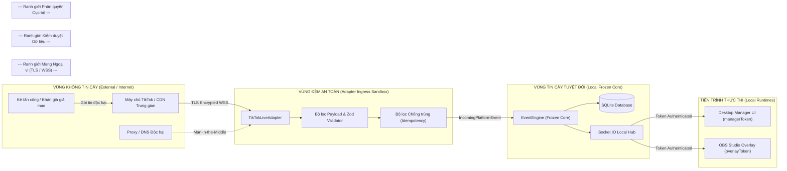

# Mô hình Đe dọa An toàn Thông tin (Security Threat Model — STRIDE)
## Tiếp nhận Sự kiện Livestream TikTok LIVE (Milestone S7)

> **Mã tài liệu:** `SEC-S7-STRIDE-01`  
> **Dự án:** BuddhaLive Studio — Hệ thống Tương tác Livestream 3D Offline-First  
> **Phương pháp luận:** Microsoft STRIDE Threat Modeling Framework  
> **Đối tượng đánh giá:** Luồng tiếp nhận sự kiện TikTok LIVE (`TikTokLiveAdapter`), Giao diện Quản lý, và Kênh Overlay OBS  
> **Trạng thái:** Bản Đánh giá An toàn Toàn diện

---

## 1. Giới thiệu và Phạm vi Đánh giá

Khi mở rộng kết nối từ môi trường offline/mô phỏng nội bộ (`DemoSimulator`) sang không gian Internet trực tiếp của TikTok (`TikTokLiveAdapter`), bề mặt tấn công (Attack Surface) của ứng dụng gia tăng đáng kể do tiếp nhận dữ liệu không tin cậy (Untrusted External Inputs) từ hàng nghìn khán giả và hạ tầng mạng công cộng.

Tài liệu này áp dụng mô hình **STRIDE** nhằm nhận diện toàn bộ các nguy cơ an ninh tiềm tàng và xác lập các biện pháp giảm thiểu (Mitigations) nghiêm ngặt trước khi triển khai mã nguồn tại Milestone S8.

---

## 2. Bề mặt Tấn công và Ranh giới Tin cậy (Trust Boundaries)

---

## 3. Ma trận Phân tích Nguy cơ Theo Mô hình STRIDE

| Mã STRIDE | Danh mục Nguy cơ | Kịch bản Tấn công Cụ thể | Mức độ Nghiêm trọng | Biện pháp Phòng vệ & Giảm thiểu Đã Thiết kế |
| :---: | :--- | :--- | :---: | :--- |
| **S** | **Spoofing** (Giả mạo danh tính) | 1. Kẻ xấu mạo danh WebSocket của TikTok để bơm sự kiện tặng quà giả. 2. Khán giả đổi tên hiển thị (Nickname) giống Admin/Streamer để lừa đảo. | **CAO (High)** | - Sử dụng giao thức WSS với xác thực chứng chỉ TLS/SSL nghiêm ngặt từ máy chủ `*.tiktok.com`. - Toàn bộ quà tặng bắt buộc phải có `giftId` và `diamondCount` hợp lệ từ bảng danh mục chính thức của TikTok. - Phân biệt rõ `senderId` (SecUID số học cố định) và `senderName`. Không cấp bất kỳ quyền quản trị nào dựa trên tên người gửi quà. |
| **T** | **Tampering** (Xáo trộn / Giả mạo dữ liệu) | 1. Can thiệp gói tin giữa đường để sửa đổi số lượng xu từ 1 xu thành 10,000 xu (để kích hoạt hiệu ứng VIP). 2. Chèn mã độc XSS/HTML/JavaScript vào Nickname người gửi hoặc Tên quà tặng nhằm tấn công màn hình Overlay. | **NGHIÊM TRỌNG (Critical)** | - Mã hóa đường truyền end-to-end qua TLS 1.3. - Bộ giải mã Protobuf phân tích cú pháp nghiêm ngặt, tự động loại bỏ các trường không nằm trong định nghĩa schema. - Toàn bộ chuỗi văn bản (`senderName`, `giftName`) được khử khuẩn (Sanitization), mã hóa thực thể HTML (HTML entity escaping) trước khi đưa vào DOM của Overlay. - Không sử dụng `innerHTML` hoặc `eval()` trong mã nguồn Overlay. |
| **R** | **Repudiation** (Chối bỏ trách nhiệm) | Người dùng hoặc streamer khiếu nại rằng hệ thống hiển thị sai hoạt ảnh hoặc ghi nhận quà tặng không có thực. | **TRUNG BÌNH (Medium)** | - **Nhật ký Bất biến (Immutable Audit Trail):** Mọi sự kiện từ TikTok đều được ghi nhận vào SQLite `live_events` kèm theo `raw_payload_json`, timestamp và `external_event_id` trước khi xử lý. - Trạng thái của từng bước (`RECEIVED`, `QUEUED`, `PLAYING`, `COMPLETED`, `COALESCED`, `EVICTED`) được gắn dấu thời gian chính xác đến mili-giây. |
| **I** | **Information Disclosure** (Rò rỉ thông tin nhạy cảm) | 1. Rò rỉ cookie phiên hoặc proxy token của streamer qua file log hoặc màn hình chẩn đoán. 2. Lộ token quản trị `managerToken` hoặc `overlayToken` cho khán giả xem livestream. | **NGHIÊM TRỌNG (Critical)** | - Vận hành mặc định ở chế độ **Zero-Credential** (chỉ dùng `@username` công khai). - Nếu có thông tin cấu hình nhạy cảm (proxy credentials), bắt buộc mã hóa qua **Windows DPAPI** trước khi lưu trữ. - Bộ lọc Log Redaction tự động rà quét và thay thế token/cookie bằng `[REDACTED]`. - Tuyệt đối không in token ra màn hình giao diện OBS Browser Source hoặc URL query string. |
| **D** | **Denial of Service** (Tấn công từ chối dịch vụ) | 1. **Gift Bomb / Flood Attack:** Khán giả gửi hàng chục nghìn quà 1 xu trong vài giây làm nghẽn bộ nhớ hoặc sập Overlay. 2. Tấn công làm cạn kiệt tài nguyên CPU/RAM hoặc gây nghẽn hàng đợi cơ sở dữ liệu. | **CAO (High)** | - **Cơ chế Gộp Combo (`COMBO_MERGE`):** Cửa sổ 1500ms gom hàng nghìn quà tặng liên tiếp thành 1 lượt duy nhất. - **Hàng đợi Giới hạn Cứng (Hard Cap):** Queue tối đa 30 lượt và tối đa 5 lượt/rule. Cơ chế `COALESCE` và `DROPPED_QUEUE_FULL` tự động cắt giảm tải khi quá ngưỡng. - **In-memory Rate Limiting:** Adapter giới hạn tối đa tiếp nhận 100 sự kiện/giây; các sự kiện vượt ngưỡng được gộp hoặc loại bỏ an toàn. |
| **E** | **Elevation of Privilege** (Leo thang đặc quyền) | Khán giả gửi nội dung chat hoặc tên tài khoản chứa chuỗi lệnh đặc biệt nhằm điều khiển các chức năng quản trị (SKIP, CLEAR, PAUSE). | **NGHIÊM TRỌNG (Critical)** | - Phân tách hoàn toàn hai vai trò quyền lực (RBAC):   + Role `manager` (yêu cầu `managerToken` để gọi lệnh điều khiển queue).   + Role `overlay` (chỉ nhận sự kiện trình diễn, không có quyền ra lệnh). - Sự kiện livestream từ khán giả chỉ là dữ liệu thụ động (Passive Data Stream), không bao giờ được diễn giải thành lệnh điều khiển hệ thống. |

---

## 4. Kế hoạch Kiểm thử An toàn Thông tin (Security Verification Plan)

Trong quá trình triển khai Milestone S8, bộ kiểm thử an toàn sẽ được thực thi tự động:
1. **XSS Injection Test Suite:** Gửi các chuỗi Nickname chứa payload độc hại (``, `">`) xác nhận Overlay hiển thị thuần text an toàn 100%.
2. **Flood & Stress Test:** Bơm 2,000 sự kiện quà tặng/giây vào `TikTokLiveAdapter` xác nhận bộ nhớ không tăng vọt (Leak-free) và SQLite không bị khóa (`database is locked`).
3. **Log Sanitization Audit:** Chạy quét regex trên toàn bộ tệp log sau 1 giờ chạy kiểm thử, đảm bảo 0% token/cookie bị lọt vào tệp ghi nhận.
4. **Credential Isolation Test:** Xác minh rằng khi file cấu hình bị copy sang máy tính khác, dữ liệu nhạy cảm được bảo vệ bởi Windows DPAPI không thể bị giải mã.

---
*Bản phân tích được phê duyệt làm cơ sở kiểm soát rủi ro an toàn thông tin cho Cột mốc S8.*
