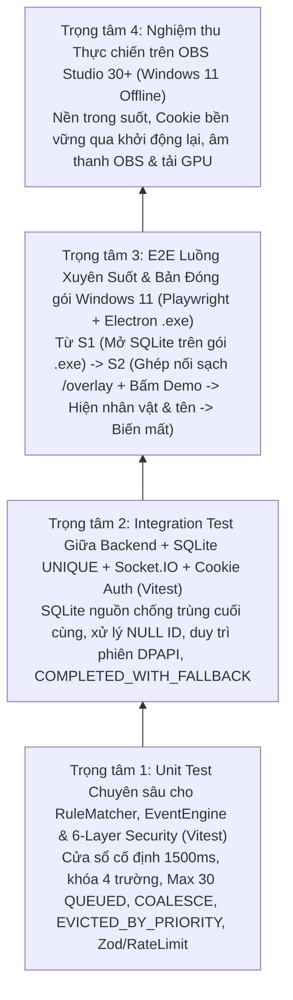

# Chiến lược Kiểm thử Thực tế — BuddhaLive Studio

> **Phiên bản:** 1.2.0 (Cập nhật kịch bản kiểm thử cho 7 chi tiết chốt thiết kế & Cổng kiểm chứng từng Milestone)  
> **Công cụ Kiểm thử:** `Vitest` (Unit & Integration) + `Playwright` (Tích hợp Giao diện / Overlay & Bản Đóng gói Electron Windows)  
> **Môi trường Mục tiêu:** Windows 11 Local (Hoạt động 100% Offline)

---

## 1. Triết lý & Tiêu chí Kiểm thử Thực tế

Dự án **không đặt chỉ tiêu bao phủ 100% dòng code hình thức** cho mọi module giao diện, mà tập trung vào **6 Tiêu chí Nghiệm thu Thực chất** gắn chặt với từng cột mốc:
1. **100% các bài kiểm thử quan trọng phải Pass** trước khi được phép chuyển sang cột mốc tiếp theo.
2. **Kiểm chứng đóng gói sớm (`S1`) và luồng xuyên suốt sớm (`S2`)** ngay trên môi trường Electron thực tế và bản đóng gói Windows (`.exe`).
3. **Kiểm thử đặc biệt kỹ `RuleMatcher` và `EventEngine`** cho toàn bộ các quy tắc gộp combo, hàng đợi, chống đói, chống trùng và cô lập lỗi.
4. **Kiểm tra đầy đủ các tình huống lỗi, biên và bảo mật 6 lớp** (token, cookie `HttpOnly`, cấm query string, redact log, allowlist, Zod, rate limit).
5. **Bắt buộc có test hồi quy (Regression Test)** sau khi sửa bất kỳ lỗi nghiêm trọng nào.
6. **Kiểm thử tích hợp thật giữa `Backend ↔ Socket.IO ↔ Live Overlay`** và chạy thực tế trên Windows 11.

---

## 2. Phân bổ Trọng tâm Kiểm thử

---

## 3. Danh mục Kịch bản Kiểm thử Cốt lõi Bắt buộc

### 3.1. Kiểm thử Chuyên sâu cho `RuleMatcher` & `EventEngine` (`Vitest`)

| Tình huống & Quy tắc `v1.2.0` | Kịch bản kiểm thử bắt buộc |
| :--- | :--- |
| **1. Combo `COMBO_MERGE` cửa sổ cố định `1500ms` & khóa 4 trường** | - Gửi Event 1 tại `t = 0ms`, Event 2 tại `t = 800ms`, Event 3 tại `t = 1400ms` cùng `(source, sender_id, gift_id, matched_rule_id)` → xác nhận cửa sổ chốt đúng tại **`t = 1500ms`** (không bị đẩy lùi sang `2900ms`), tạo đúng 1 `Execution` gộp 3 quà; Event 4 tại `t = 1600ms` mở cửa sổ mới. - Thay đổi bất kỳ 1 trong 4 thành phần khóa (`source`, `sender_id`, `gift_id` hoặc `matched_rule_id`) → xác nhận tách thành 2 bộ đệm combo độc lập. |
| **2. Nhiều người gửi cùng lúc & Chống đói chỉ trên `QUEUED`** | - Xếp hàng đúng `priority DESC, queued_at ASC`. - Xác nhận bộ đếm chống đói **chỉ quét các bản ghi `status = 'QUEUED'`** chờ `>= 30s` sau 3 lượt ưu tiên cao liên tiếp; tuyệt đối không can thiệp vào sự kiện đang nằm trong bộ đệm combo hay lượt đang `PLAYING`. |
| **3. Nhân vật đang hoạt ảnh (`1000ms` bảo vệ)** | - Mặc định `QUEUE` chờ chạy hết. - `PREEMPT_LOWER` chỉ được thay thế khi `priority` cao hơn và lượt đang diễn đã chạy `>= 1000ms`, chuyển lượt cũ sang `PREEMPTED`. |
| **4. Trần `30` lượt `QUEUED`, khóa `COALESCE` & `EVICTED_BY_PRIORITY`** | - Đang có 1 lượt `PLAYING` + `30` lượt `QUEUED` (tổng bản ghi hoạt động là 31, đúng trần `30 QUEUED`). - Khi sự kiện mới khớp khóa `(source, sender_id, gift_id, gift_rule_id)` với một bản ghi đang `QUEUED` → cộng dồn `merged_gift_count` vào bản ghi `QUEUED` đó (`COALESCED_INTO_QUEUE`), không cộng vào bản ghi đang `PLAYING`. - Khi `30/30 QUEUED` đầy và không khớp `COALESCE`: quà ưu tiên thấp hơn/bằng bị từ chối (`DROPPED_QUEUE_FULL`); quà VIP ưu tiên cao hơn đẩy phần tử `QUEUED` ưu tiên thấp nhất (vào muộn nhất) sang trạng thái **`EVICTED_BY_PRIORITY`** rồi vào hàng đợi. |
| **5. Chống trùng SQLite `UNIQUE` & `external_event_id NULL`** | - Xóa trắng bộ đệm LRU trong RAM rồi gửi lại sự kiện có cùng `(source, external_event_id)` → xác nhận SQLite `UNIQUE` chặn đứng, không sinh `Execution` thứ hai. - Gửi liên tiếp 3 sự kiện có `external_event_id` lần lượt là `null`, `""` và `"   "` → xác nhận cả 3 được chuẩn hóa về `NULL` và đều được SQLite xử lý độc lập từng sự kiện một (không chặn nhầm nhau và không văng lỗi constraint). |
| **6. Overlay bị tải lại giữa chừng** | - Ngắt kết nối Overlay khi đang `PLAYING` → bản ghi dở chuyển sang `CANCELLED` (`OVERLAY_RELOADED`); khi kết nối lại nhận `system:state_snapshot` và phát tiếp lượt `QUEUED` kế tiếp. |
| **7. Lỗi Model 3D & `COMPLETED_WITH_FALLBACK`** | - Khi lỗi `.glb`/clip nhưng `fallback_2d_alert = true` hiển thị xong bảng 2D tên người tặng → xác nhận `EventExecution.status` được ghi nhận là **`COMPLETED_WITH_FALLBACK`** (kèm mã cảnh báo lỗi 3D), không ghi `FAILED`. - Khi tắt `fallback_2d_alert = false` và lỗi `.glb` → xác nhận ghi `FAILED` và hàng đợi vẫn đi tiếp sang sự kiện kế tiếp. |
| **8. Crash Recovery & Khôi phục Trạng thái An toàn khi Khởi động lại** | - Crash khi đang `DISPATCHED` hoặc `PLAYING`: khi khởi động lại, giao dịch phục hồi tự động chuyển các bản ghi này sang `CANCELLED` (`error_code = 'SERVER_RESTARTED'`), bảo đảm không phát lại lượt đang diễn dở trước khi crash. - Các bản ghi `QUEUED` được bảo toàn nguyên vẹn và tiếp tục phát khi Overlay kết nối sẵn sàng. - Crash khi đã `COMPLETED`: giữ nguyên trạng thái `COMPLETED` và `finished_at`, không phát lại. |

---

### 3.2. Kiểm thử Bảo mật 6 Lớp cho Server Cục bộ (`Vitest` Integration)
1. **Cấm Token trên Query String & Redact Log:**
   - Gọi `GET /overlay?token=abc` hoặc bắt tay Socket.IO có `?overlayToken=abc` → bị từ chối ngay với `400 TOKEN_IN_QUERY_FORBIDDEN`.
   - Thu toàn bộ đầu ra logger trong phiên ghép nối, xác thực và báo lỗi → quét chuỗi khẳng định **không xuất hiện giá trị `managerToken`, `overlayToken` hay `bls_overlay_session`** ở bất kỳ dòng log nào.
2. **Ghép nối Cookie `HttpOnly` & Duy trì qua Khởi động lại:**
   - Thực hiện ghép nối Overlay → nhận cookie `HttpOnly; SameSite=Strict`; tắt tiến trình Backend/Electron rồi khởi động lại trên cùng thư mục `%APPDATA%` tạm → xác nhận Overlay kết nối lại bằng cookie cũ thành công ngay lập tức; sau khi gọi lệnh Thu hồi phiên (`Revoke`) bằng `managerToken` → cookie cũ bị từ chối (`OVERLAY_PAIRING_REQUIRED`).
3. **Phân quyền Vai trò, `Origin`/`Host`, Allowlist, Zod & Rate Limit:**
   - Dùng phiên `OVERLAY` gửi lệnh trong `MANAGER_EVENT_ALLOWLIST` → bị chặn `FORBIDDEN_ROLE`.
   - Gửi tên sự kiện ngoài allowlist → `EVENT_NOT_ALLOWED`; gửi thừa trường lạ vào payload → `VALIDATION_ERROR` (Zod `.strict()`); spam vượt ngưỡng tần suất → `RATE_LIMITED`.
   - Upload file sai Magic Bytes `"glTF"` hoặc đọc `/assets/../../...` → bị chặn `400/403`.

---

### 3.3. Kiểm thử Đóng gói Windows 11 & Luồng Xuyên Suốt (`S1` → `S2` → `S5`)
- **Cổng nghiệm thu `S1` (`pnpm test` & Kiểm chứng gói `.exe` Windows):**
  - Build gói ứng dụng Electron thực tế trên Windows 11 (`electron-builder --dir`).
  - Khởi chạy trực tiếp file `.exe` đã đóng gói: xác nhận mở `better-sqlite3` từ `app.asar.unpacked`, bật `WAL`, chạy migration tạo bảng và ghi/đọc dữ liệu SQLite thành công không lỗi ABI.
- **Cổng nghiệm thu `S2` (Walking Skeleton End-to-End):**
  - Ghép nối trang `http://127.0.0.1:3721/overlay` (không query token) → bấm nút Demo gửi quà từ `"Minh Anh"` → xác nhận qua DOM hooks (`data-overlay-state`, `data-sender-name`, `data-active-execution-id`, `data-active-clip`) nhân vật hiện lên, chạy hoạt ảnh, hiện đúng tên `"Minh Anh"`, sau đó biến mất về `HIDDEN_STANDBY` và lưu `COMPLETED`.

---

### 3.4. Kiểm thử Cột mốc S4: Quản lý Đa Nhân vật, Hoạt ảnh, Gift Rule & Desktop Manager UI

| Nhóm kiểm thử S4 | Kịch bản & Tiêu chí Nghiệm thu Bắt buộc |
| :--- | :--- |
| **1. Upload GLB & Trích xuất AnimationClip Thực tế** | - Upload file `.glb` hợp lệ có header `"glTF"` (`0x46546C67`) thành công và lưu với tên UUID chống Path Traversal. - Upload file giả mạo định dạng (ví dụ file exe/txt đổi đuôi `.glb`) bị chặn ngay ở tầng kiểm tra Magic Bytes. - Module GLB Parser trích xuất chính xác 100% danh sách `animations[].name` từ chunk JSON nhị phân của file GLB mà không cần khởi tạo Three.js. - Không giả định các model có cùng tên clip (mỗi model có danh sách clip riêng biệt). |
| **2. Quản lý Đa Nhân vật (CRUD & Active State)** | - Tạo mới, cập nhật tên, mô tả, scale, position (x, y, z), rotation (x, y, z), visibility_mode (`APPEAR_ON_EVENT`/`PERSISTENT_IDLE`). - Chuyển đổi nhân vật kích hoạt: SQLite index duy nhất `idx_characters_single_active` bảo đảm tại mọi thời điểm chỉ có đúng 1 nhân vật `is_active = 1`. - Xử lý ràng buộc an toàn: Không cho phép xóa nhân vật đang `is_active = 1` hoặc báo lỗi/yêu cầu xác nhận rõ ràng nếu xóa nhân vật kéo theo cascade các hoạt ảnh/quy tắc. |
| **3. Quản lý Hoạt ảnh & Ràng buộc RESTRICT** | - CRUD hoạt ảnh: ánh xạ hành động sang clip thực tế chọn từ danh sách clip trích xuất của model GLB. - Cấu hình thời lượng, loop mode, repeat count, blend in/out, âm thanh. - **Kiểm tra ràng buộc phụ thuộc:** Chặn tuyệt đối hành vi xóa hoạt ảnh đang được `gift_rules` tham chiếu (`ON DELETE RESTRICT`) và trả về thông báo lỗi chi tiết nêu rõ danh sách quy tắc đang sử dụng. |
| **4. Quản lý Gift Rule & Tính Bất biến của Lượt đang PLAYING** | - CRUD Gift Rule: cấu hình Gift ID, nhân vật, hoạt ảnh, priority (1-100), số lượng quà tối thiểu, giá trị xu tối thiểu, combo mode, bật/tắt. - **Quy tắc kỹ thuật bất biến:** Khi chỉnh sửa hoặc vô hiệu hóa Gift Rule, cấu hình mới chỉ ảnh hưởng đến các Event/Execution tiếp theo, **tuyệt đối không làm thay đổi hoặc gián đoạn lượt thực thi đang ở trạng thái `PLAYING` hoặc `DISPATCHED`**. |
| **5. An toàn Crash trong Cửa sổ Combo 1500ms** | - Giả lập crash ứng dụng xảy ra đúng khi các Event đang nằm trong cửa sổ `COMBO_MERGE 1500ms` (đã lưu trong `live_events` nhưng chưa đến hạn tạo `EventExecution`). - Khi khởi động lại ứng dụng: kiểm chứng không làm mất Event trong `live_events`, không sinh Execution trùng lặp và khôi phục trạng thái nhất quán. |
| **6. E2E Flow trên Desktop Manager & OBS Smoke Test** | - Playwright E2E: Đăng nhập Manager bằng `managerToken` → Tạo nhân vật mới → Tải tệp GLB → Ánh xạ AnimationClip thực tế → Tạo Gift Rule cho nhân vật mới → Bấm Demo kích hoạt quà mới → Live Overlay nhận lệnh, hiển thị đúng model mới, chạy đúng clip mới và biến mất. - Smoke test trên OBS Studio thật với bản đóng gói Windows 11 (`BuddhaLive Studio.exe`). |
