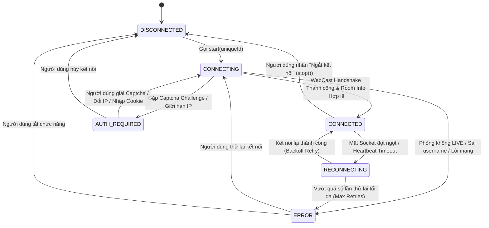
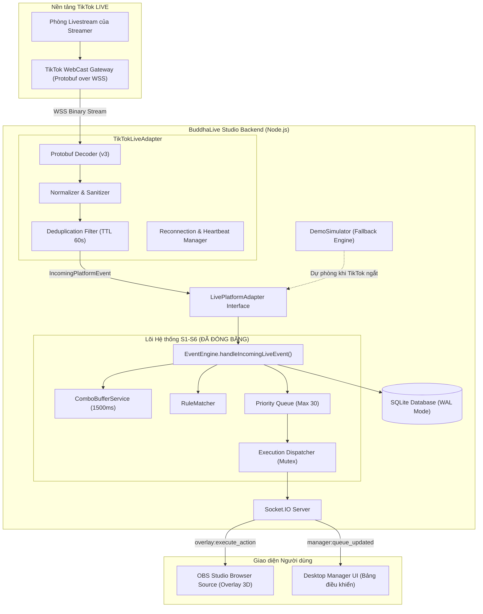

# Thiết kế Kiến trúc TikTokLiveAdapter (Milestone S7 — T-22)

> **Mã công việc:** `T-22` (Hoàn thiện Kiến trúc & Thiết kế Tích hợp)  
> **Dự án:** BuddhaLive Studio — Hệ thống Tương tác Livestream 3D Offline-First  
> **Kế thừa & Tuân thủ:** Interface `LivePlatformAdapter`, `EventEngine`, SQLite WAL Database Schema, Frozen Core S1–S6  
> **Trạng thái:** Bản thiết kế Kiến trúc Chuẩn mực (Specification Document)

---

## 1. Mục tiêu và Nguyên tắc Thiết kế

Tài liệu này xác lập chi tiết thiết kế kỹ thuật của thành phần `TikTokLiveAdapter` chuẩn bị cho Milestone S8. 

### Nguyên tắc Bất khả Xâm phạm (Architecture Non-Negotiables):
1. **Bảo tồn Lõi Đã Đóng băng (Frozen Core Integrity):** Tuyệt đối không thay đổi mã nguồn hay logic nghiệp vụ của `EventEngine`, `RuleMatcher`, `Queue`, `ComboBuffer`, và `ExecutionDispatcher`.
2. **Tuân thủ Hợp đồng Giao tiếp (Interface Compliance):** `TikTokLiveAdapter` bắt buộc cài đặt đầy đủ hợp đồng `LivePlatformAdapter` sẵn có tại `apps/backend/src/adapters/live-platform-adapter.ts`.
3. **Trung thực Trạng thái (Honest State Machine):** Trạng thái kết nối phải phản ánh 100% tình trạng vật lý của kết nối, không giả lập `CONNECTED` khi chưa thiết lập luồng dữ liệu thực tế.
4. **An toàn Thông tin Xác thực (Zero-Credential Vulnerability):** Vận hành chỉ cần Streamer `@uniqueId` công khai. Tuyệt đối không yêu cầu mật khẩu người dùng, không lưu trữ token nhạy cảm dạng plaintext.
5. **Dự phòng Độc lập (Fail-safe Fallback):** Khi mất kết nối hoặc lỗi giao thức TikTok, hệ thống tự động rơi về trạng thái an toàn và cho phép kích hoạt `DemoSimulator` tức thì mà không cần khởi động lại ứng dụng hoặc Overlay.

---

## 2. Đặc tả Chuẩn hóa Sự kiện Livestream (`NormalizedLiveEvent`)

Mọi sự kiện từ TikTok (thông qua WebCast Protobuf hoặc dịch vụ trung gian) phải được giải mã và chuyển hóa thành định dạng phẳng, chuẩn hóa `NormalizedLiveEvent` (tương thích `IncomingPlatformEvent` và `IngestLiveEventParams`) trước khi đẩy vào `EventEngine`.

### 2.1. Cấu trúc Dữ liệu `NormalizedLiveEvent`

```typescript
export interface NormalizedLiveEvent {
  /** Nguồn gốc sự kiện: luôn là 'TIKTOK' khi nhận từ luồng livestream */
  source: 'TIKTOK';

  /** Loại sự kiện livestream */
  eventType: 'GIFT' | 'LIKE' | 'CHAT' | 'FOLLOW' | 'SHARE';

  /** Nhà cung cấp trung gian / Phương thức kết nối */
  provider: 'TIKFINITY' | 'EULERSTREAM' | 'DEMO' | 'CUSTOM';

  /** Mã sự kiện duy nhất ngoại vi phục vụ chống trùng */
  externalEventId: string;

  /** Phân loại chiến lược định danh: 
   * - 'EXTERNAL_STABLE': ID duy nhất bền vững do chính Provider/TikTok cấp (ví dụ TikFinity actionId, Webcast msgId)
   * - 'SYNTHETIC_DETERMINISTIC': ID tổng hợp xác định (Deterministic Hash) khi Provider không có ID gốc
   */
  idStrategy: 'EXTERNAL_STABLE' | 'SYNTHETIC_DETERMINISTIC';

  /** ID sự kiện nguyên bản do Provider cung cấp (nếu có) */
  providerEventId?: string | null;

  /** Định danh người gửi (SecUID hoặc User ID số học) */
  senderId: string;

  /** Tên hiển thị công khai (Nickname) của người gửi quà */
  senderName: string;

  /** Đường dẫn ảnh đại diện người gửi (có thể null nếu mạng chặn CDN) */
  senderAvatarUrl?: string | null;

  /** Định danh Quà tặng TikTok (Gift ID số học dạng chuỗi, vd: "5655" = Hoa hồng) */
  giftId: string;

  /** Tên quà tặng tiếng Việt/Anh do TikTok trả về (vd: "Rose", "Chiếc Nhẫn") */
  giftName: string;

  /** Số lượng quà trong đợt gửi này (Batch count / Repeat count) */
  giftCount: number;

  /** Đơn giá xu (Coins) của 1 phần quà */
  unitCoinValue: number;

  /** Tổng giá trị xu trong đợt gửi này: giftCount * unitCoinValue */
  totalCoinValue: number;

  /** ID nhóm combo để nhận diện chuỗi gộp quà liên tiếp */
  comboGroupId?: string | null;

  /** Cờ báo hiệu chuỗi combo từ người gửi này đã kết thúc */
  isComboEnd?: boolean;

  /** Timestamp thời điểm sự kiện diễn ra trên máy chủ nguồn (Epoch ms) */
  platformTimestamp: number;

  /** Siêu dữ liệu bổ sung từ Provider (phiên bản API, latency, socketId) */
  providerMetadata?: Record<string, unknown>;

  /** Bản tin gốc dạng JSON phục vụ Audit Log và Debug khi có sự cố */
  rawPayload: Record<string, unknown>;
}
```

### 2.2. Quy tắc Ánh xạ Dữ liệu Chi tiết (Field Mapping Rules)

Khi nhận gói tin `WebcastGiftMessage` từ TikTok WebCast:

| Trường TikTok Gốc (`WebcastGiftMessage`) | Trường Chuẩn hóa (`NormalizedLiveEvent`) | Quy tắc Xử lý & Chuẩn hóa |
| :--- | :--- | :--- |
| `msgId` / `common.msgId` | Dùng tạo `externalEventId` | Tạo định danh duy nhất (xem Mục 5.1). |
| `user.id` hoặc `user.secUid` | `senderId` | Ưu tiên dùng chuỗi số học `user.id` cố định. |
| `user.nickname` hoặc `user.uniqueId` | `senderName` | Lấy `nickname`, nếu rỗng lấy `uniqueId`. Giới hạn tối đa 64 ký tự để tránh vỡ giao diện Overlay. |
| `user.profilePictureUrls[0]` | `senderAvatarUrl` | Lấy URL kích thước 100x100; fallback sang null nếu không có. |
| `giftId` | `giftId` | Chuỗi định danh số học duy nhất của quà TikTok. |
| `giftDetails.giftName` | `giftName` | Tên quà tặng, fallback sang `"TikTok Gift #<giftId>"` nếu không đọc được. |
| `repeatCount` / `comboCount` | `giftCount` | **Lưu ý nghiệp vụ:** TikTok gửi quà combo tăng dần (1, 2, 3...). Adapter tính toán độ chênh (Delta) hoặc trích xuất số lượng tăng thêm để tránh cộng dồn thừa quà. |
| `giftDetails.diamondCount` | `unitCoinValue` | Giá trị kim cương/xu của 1 quà tặng. |
| `giftCount * unitCoinValue` | `totalCoinValue` | Tự động tính toán số học chính xác. |
| `groupId` | `comboGroupId` | Nhóm combo của người tặng. |
| `repeatEnd` (0 hoặc 1) | `isComboEnd` | Chuyển đổi: `repeatEnd === 1`. |
| `common.createTime` | `platformTimestamp` | Chuyển đổi timestamp TikTok (giây) sang mili-giây. |

---

## 3. Máy Trạng thái Vòng đời Kết nối (Connection Lifecycle State Machine)

Kết nối giữa `TikTokLiveAdapter` và TikTok WebCast tuân thủ máy trạng thái hữu hạn (FSM) gồm 6 trạng thái vật lý rõ ràng:



### 3.1. Ý nghĩa Chi tiết Các Trạng thái

1. **`DISCONNECTED` (Đã ngắt kết nối):**
   - Trạng thái mặc định khi khởi động ứng dụng hoặc khi streamer chủ động ngắt kết nối.
   - Không có tiến trình mạng ngầm, không tiêu tốn tài nguyên CPU/RAM.
2. **`CONNECTING` (Đang kết nối):**
   - Đang phân giải HTML của `https://www.tiktok.com/@username/live` để lấy `roomId` và tiến hành bắt tay WebSocket Protocol Buffers.
   - Bảng điều khiển Desktop hiển thị biểu tượng loading màu vàng.
3. **`CONNECTED` (Đã kết nối):**
   - Kênh WebSocket nhị phân đang duy trì Heartbeat (Ping/Pong định kỳ mỗi 10 giây).
   - Sự kiện Quà tặng/Bình luận được giải mã và đẩy vào `EventEngine` theo thời gian thực.
   - Desktop Manager hiển thị badge màu xanh lá: **"TikTok LIVE: Đang kết nối (@username)"**.
4. **`RECONNECTING` (Đang tự động kết nối lại):**
   - Kích hoạt khi rớt mạng cục bộ hoặc máy chủ TikTok ngắt kết nối đột ngột.
   - Kích hoạt thuật toán Thử lại Lũy thừa có Jitter (Exponential Backoff with Jitter).
5. **`ERROR` (Gặp lỗi):**
   - Streamer chưa phát LIVE (Streamer Offline), tài khoản không tồn tại, hoặc lỗi DNS mạng.
   - Kèm theo thông báo lỗi song ngữ rõ ràng cho streamer trên UI.
6. **`AUTH_REQUIRED` (Yêu cầu xác thực bổ sung):**
   - TikTok trả về phản hồi yêu cầu Captcha (HTTP 429 hoặc Trang xác thực trượt hình).
   - Hướng dẫn streamer cách xử lý: Chờ 2 phút, đổi IP hoặc nhập phiên làm việc dự phòng.

---

## 4. Kiến trúc Tích hợp và Luồng Dữ liệu (Integration Architecture)

Sơ đồ thể hiện đường đi của dữ liệu từ TikTok Internet tới Overlay Browser Source:



---

## 5. Các Giải pháp Kỹ thuật Trọng yếu

### 5.1. Chiến lược Định danh và Chống Trùng lặp Sự kiện (Deduplication & Idempotency)

Trong môi trường livestream, mạng lag có thể khiến Provider gửi lại cùng một gói tin sự kiện nhiều lần (duplicate packets). Để đảm bảo tính toàn vẹn, `TikTokLiveAdapter` áp dụng cơ chế 3 lớp nghiêm ngặt và trung thực về mặt hợp đồng:

1. **Phân biệt Rạch ròi External Event ID vs. Synthetic Internal ID:**
   - **`EXTERNAL_STABLE` (External Event ID):** Nếu Provider (hoặc TikTok WebCast) cung cấp một mã sự kiện duy nhất ổn định từ máy chủ gốc (ví dụ: TikFinity `actionId`, WebSocket `msgId`), Adapter sẽ dùng trực tiếp định danh này làm `externalEventId`. Trường hợp này hệ thống đạt được tính chất bảo toàn chống trùng tin cậy cao.
   - **`SYNTHETIC_DETERMINISTIC` (Synthetic Internal ID):** Nếu Provider không cung cấp ID gốc hoặc ID bị trùng lặp trong chuỗi combo, Adapter buộc phải tính toán khóa xác định:
     $$\text{syntheticEventId} = \text{SHA256}(\text{provider} + \text{roomId} + \text{senderId} + \text{giftId} + \text{comboCount} + \text{platformTimestamp})$$
   - **Nguyên tắc Hợp đồng:** Hệ thống **tuyệt đối không tuyên bố Exactly-Once Delivery nếu Provider không cung cấp định danh ổn định**. Khi đó, hợp đồng vận hành được xác định là **At-Least-Once Delivery kèm Best-Effort Deduplication**.

2. **Lớp 2: Bộ nhớ Đệm Cục bộ (In-Memory LRU Cache):**
   - Duy trì một danh sách các `externalEventId` đã xử lý trong vòng 60 giây gần nhất (kích thước tối đa 2,000 mục).
   - Nếu ID đã tồn tại trong cache, loại bỏ ngay tại cửa ngõ Adapter mà không cần truy vấn SQLite, giúp giảm tải I/O tối đa.

3. **Lớp 3: SQLite UNIQUE Constraint (Rào chắn Cuối cùng):**
   - Cơ sở dữ liệu SQLite tại bảng `live_events` có ràng buộc duy nhất trên cột `external_event_id`. Nếu có gói tin lọt qua lớp 1 và 2, SQLite sẽ từ chối với mã `SQLITE_CONSTRAINT_UNIQUE` mà không gây lỗi ứng dụng.

4. **Cô lập Tuyệt đối giữa Adapter và Lõi Nghiệp vụ:**
   - Adapter **tuyệt đối không được phép truy cập trực tiếp vào `EventEngine` hoặc Repository cơ sở dữ liệu**.
   - Mọi tương tác duy nhất từ Adapter là phát sự kiện qua callback `LivePlatformAdapter.onEvent(IncomingPlatformEvent)`. Tầng Ingress của Backend chịu trách nhiệm chuyển giao an toàn vào `EventEngine`.

### 5.2. Chiến lược Kết nối lại Lũy thừa có Jitter (Exponential Backoff with Jitter)

Khi mất kết nối Socket, adapter tự động kết nối lại theo thuật toán chuẩn RFC:
$$t_{\text{wait}} = \min(t_{\text{max}}, t_{\text{base}} \times 2^{\text{retryCount}}) + \text{random}(0, 1000)\text{ ms}$$

- **Thông số cấu hình:**
  - $t_{\text{base}} = 1000\text{ ms}$ (1 giây).
  - $t_{\text{max}} = 30000\text{ ms}$ (30 giây).
  - Tối đa 5 lần thử lại liên tiếp. Nếu sau 5 lần vẫn thất bại, chuyển trạng thái sang `ERROR` và gửi thông báo tới Desktop Manager để streamer kiểm tra lại đường truyền mạng.

### 5.3. Mô hình An toàn Lưu trữ Thông tin Xác thực (Credential Security Model)

1. **Quy tắc Vận hành An toàn với Provider:**
   - Các API Key của Provider (TikFinity hoặc EulerStream) **bắt buộc phải được mã hóa trước khi ghi đĩa bằng Windows Data Protection API (DPAPI)** thông qua API hệ điều hành Windows (`CryptProtectData`).
   - Tuyệt đối không lưu trữ API Key dạng plaintext trong CSDL hoặc file cấu hình JSON.
   - BuddhaLive Studio **không bao giờ hỏi hoặc yêu cầu streamer nhập mật khẩu TikTok**.
2. **Bộ lọc Tuyệt đối trên Hệ thống Log (Log Redaction):**
   - Mọi bản tin log hoặc file chẩn đoán lỗi xuất ra từ Adapter đều đi qua bộ lọc Regex tự động xóa bỏ chuỗi API key, token, cookie hoặc thông tin header nhạy cảm trước khi ghi đĩa.
3. **Xác thực Dữ liệu Đầu vào bằng Zod (Zod Schema Validation):**
   - Mọi gói tin nhận từ WebSocket của Provider bắt buộc phải vượt qua Zod schema `.strict()`. Mọi gói tin có cấu trúc dị thường hoặc chứa trường không mong muốn đều bị từ chối ngay tại biên.

### 5.4. Cơ chế Xử lý Mất kết nối & Ranh giới Chế độ (Strict Mode Isolation)

1. **Cô lập Lỗi và Giữ nguyên Trạng thái:**
   - Nếu kết nối tới Provider bị đứt giữa buổi stream, Adapter chuyển trạng thái sang `RECONNECTING` hoặc `ERROR`/`DISCONNECTED`.
   - Các Execution đang ở trạng thái `PLAYING` trên màn hình vẫn tiếp tục phát hết hoạt ảnh bình thường nhờ tính chất độc lập của `EventEngine`.
2. **CẤM TỰ ĐỘNG CHUYỂN TỪ LIVE SANG DEMO:**
   - **Tuyệt đối không tự động chuyển chế độ LIVE sang DEMO khi rớt kết nối.** Việc tự động nhảy sang demo có thể dẫn đến việc phát quà giả mạo trong khi streamer đang phát trực tiếp, gây rủi ro nghiêm trọng về niềm tin khán giả và hiểu lầm về tài chính.
   - Bất kỳ thao tác chuyển đổi nguồn sự kiện nào (từ LIVE sang DEMO hoặc ngược lại) **bắt buộc phải có sự xác nhận chủ động bằng tay của Quản trị viên (Manager)** trên giao diện Desktop Manager.
3. **CẤM PHÁT EVENT DEMO GIẢ TRONG PHIÊN LIVE:**
   - Khi hệ thống đang ở chế độ kết nối LIVE (`status = 'CONNECTED'`), các nút phát quà Demo hoặc kịch bản mô phỏng phải bị vô hiệu hóa (disabled) hoặc bị chặn từ chối ở tầng Backend để bảo đảm không có sự kiện giả mạo nào bị trộn lẫn vào luồng thật.

---
*Tài liệu được thiết kế nhằm đảm bảo khả năng mở rộng tối đa cho Cột mốc S8.*
